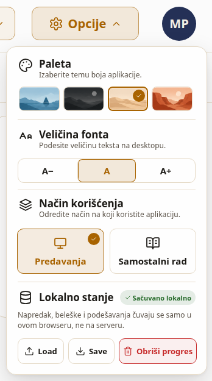
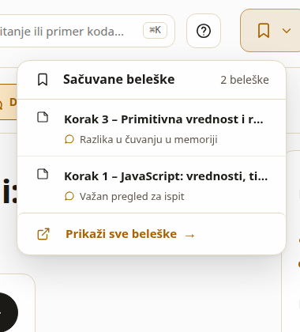

# Izgled sajta časa i lokalno stanje

Ovaj dokument opisuje raspored sajta časa, panel Opcije, beleške koraka i lokalno stanje koje sajt čuva u browseru. Specifikacije su `openspec/specs/sajt-casa`, `opcije-sajta`, `beleske-koraka` i `lokalno-stanje`. Odluka o jednom zapisu je u `docs/adr/0016-stanje-je-jedan-lokalni-zapis.md`.

## Raspored

Na širini većoj od 860 px strana ima tri pojasa: zaglavlje, traku časa i sadržaj koraka.

### Zaglavlje

Zaglavlje (`header.top`) je jedan red visok 86 px. Elementi idu sleva nadesno:

| Element | Šta radi |
| --- | --- |
| Grb i ustanova | Ime ustanove u dva reda. Klik vodi na uvod. |
| Razdelnik | Vertikalna linija između ustanove i kursa. |
| Slika i naslov kursa | `slika` i `naslov` iz `kurs.json`. Isporučeni kurs pokazuje `/img/kurs.svg` i naslov Web programiranje, u boji naglaska. |
| Pretraga | Polje Nađi pojam, pitanje ili primer koda sa predlozima. |
| Pomoć | Dijalog sa kratkim uputstvom. |
| Dugme beleški | `bookmark` i `chevron-down`. Otvara spisak beleški koraka. |
| Dugme Opcije | `settings`, Opcije i strelica koja se okreće kad je panel otvoren. |
| Oznaka | Krug 56 px sa oznakom iz `kurs.json` (na maketi MP). |

### Traka časa

Odmah ispod zaglavlja je traka časa (`nav.traka-casa`, kod u `site/js/traka-casa.js`):

- Izbor teme: `layers`, natpis Tema n – naslov i `chevron-down`. Lista ima Uvod i sve teme. Otvorena tema nosi `aria-current="page"`. Izbor teme otvara njen poslednji otvoren korak.
- Izbor koraka: `chevron-left`, natpis Korak n od N – naslov sa listom svih koraka teme, `chevron-right`. Prethodni je onemogućen na prvom koraku, Sledeći na poslednjem. Promena koraka ostavlja otvoren tab.
- Tabovi Gradivo, Diskusija i Editor.

Na uvodu se vidi samo izbor teme. Liste rade i tastaturom: strelica nadole otvara listu i fokusira prvu stavku, strelice se kreću kroz listu, Enter bira, Escape zatvara i vraća fokus na dugme. Otvorena je najviše jedna padajuća lista (`site/js/padajuca.js`): otvaranje Opcija zatvara beleške i obrnuto.

### Šta je otišlo iz zaglavlja

| Ranije u zaglavlju | Sada |
| --- | --- |
| Klizač tema, natpis teme, prethodna i sledeća tema | Izbor teme u traci časa |
| Meni palete | Odeljak Paleta u Opcijama |
| Kontrole veličine teksta | Odeljak Veličina fonta u Opcijama |
| Prekidač Predavanja / Samostalni rad | Odeljak Način korišćenja u Opcijama i prvi izbor režima |
| Sačuvaj korak | Dugme u lekciji; sačuvani koraci su pod dugmetom beleški |

### Jedna kolona

Na 860 px i uže traka časa se ne crta. Tabovi su u glavi časa, ispod reda za navigaciju, a izbor teme i koraka ide kroz mobilnu navigaciju. Opcije su u sheetu Podešavanja (`#mobil-podesavanja`) sa iste četiri sekcije, bez mera makete.

## Opcije



Maketa panela i spiska beleški je `mocks/opcije-i-beleske.png`. Snimak iznad je sajt na istom viewportu (1672 × 941) u paleti Pesak. Kod je u `site/js/opcije.js`.

Panel se otvara dugmetom Opcije. Zatvaraju ga Escape, klik van panela i ponovni klik na dugme; fokus se vraća na dugme. Panel ima 330 × 539 px, vrh na 76 px i desnu ivicu 8 px od ivice prozora. Sve mere su u `px`, pa A+ i predavanja ne menjaju panel. Boje dolaze iz palete; nova su samo tri tokena po paleti: `--uspeh`, `--upozorenje` i `--opasnost`, svaki sa kontrastom bar 4.5:1 prema `--paper`.

### Odeljci

| Odeljak | Sadržaj |
| --- | --- |
| Paleta | Četiri pločice sa slikama iz `site/icons/teme/`: Plava (`mornar`), Ugalj, Pesak i Terakota. Izbor zakuca paletu, upiše je u `paleta` i ostavlja panel otvoren. Izabrana pločica ima kvačicu. |
| Veličina fonta | Segment A− / A / A+ (`0.875`, `1`, `1.125`). Upisuje `podesavanja.font`. |
| Način korišćenja | Kartice Predavanja (`monitor`) i Samostalni rad (`book-open-text`). Promena ostavlja isti korak. Upisuje `podesavanja.mod`. |
| Lokalno stanje | Bedž Sačuvano lokalno, ili Nije sačuvano kad `localStorage` odbije upis. Load uvozi fajl stanja, Save preuzima `web-programiranje-stanje.json`, Obriši progres posle potvrde briše napredak, beleške i podešavanja bez ponovnog učitavanja strane. Radne verzije ostaju. |

Pogrešan fajl na Load ne menja stanje; ispod dugmadi piše da fajl nije sačuvano stanje.

### Prvi izbor režima

Kad `podesavanja.mod` nije izabran (prvi dolazak ili posle Obriši progres), sajt otvara dijalog Kako koristite aplikaciju? sa iste dve kartice. Izbor se upisuje i dijalog se više ne pojavljuje. Escape upisuje Predavanja. Kasnije se način menja u Opcijama.

### Veličina teksta u oba režima

U samostalnom radu koren strane ima `font-size: calc(16px * var(--skala-fonta))`, a u predavanjima `calc(16px * var(--skala-predavanja) * var(--skala-fonta))` sa `--skala-predavanja: 1.3`. Izbor A− / A / A+ postavlja `--skala-fonta`, pa radi u oba režima: A+ u predavanjima daje 16 × 1.3 × 1.125 px.

## Beleške

Beleška je obeleživač jednog koraka sa kratkim komentarom, npr. šta studentu nije jasno. Svaki korak ima najviše jednu belešku. Beleška nije ocena i ne ide na server. Kod je u `site/js/beleske.js`, a beleške su polje `beleske` u lokalnom stanju.

### Čuvanje

Sačuvaj korak u lekciji otvara mali uređivač ispod dugmeta: polje Šta nije jasno u ovom koraku? (do 500 znakova), Sačuvaj i, kad korak već ima belešku, Ukloni. Komentar može da ostane prazan. Kad otvoren korak ima belešku, dugme pokazuje `bookmark-filled` i `aria-pressed="true"`. Escape i klik van uređivača zatvaraju ga bez izmene; Escape vraća fokus na dugme. Na jednoj koloni isti uređivač otvara Sačuvaj korak iz sheeta Podešavanja.

### Spisak u zaglavlju



Dugme beleški u zaglavlju (`bookmark` i `chevron-down`) otvara spisak Sačuvane beleške, levo od Opcija (342 px širine, na maketi 342 × 248 sa dve beleške). Gore je broj beleški u srpskoj množini (`brojBeleski`: 1 beleška, 3 beleške, 5 beležaka, 21 beleška), ispod pet poslednjih izmenjenih (`najnovije`): `sticky-note`, Korak n – naslov u jednom redu i komentar sa `message-circle`. Bez beleški piše Nema sačuvanih beleški. Na dnu je Prikaži sve beleške sa `external-link`.

Izbor beleške otvara njenu temu i korak i ostavlja otvoren tab: skok sa Editora ostaje na Editoru. Spisak radi i tastaturom: Enter na dugmetu otvara, strelice se kreću kroz redove, Enter bira, Escape zatvara i vraća fokus na dugme. Komentar se upisuje kao tekst, nikad kao HTML.

### Sve beleške, izmena i brisanje

Prikaži sve beleške otvara dijalog sa svim beleškama, grupisanim po temi pa po koraku (`poTemama`). Svaka beleška ima polje komentara i Ukloni. Izmena se upisuje kad polje izgubi fokus (`change`); brisanje odmah sklanja belešku iz dijaloga, iz spiska u zaglavlju i iz stanja. Escape zatvara dijalog i vraća fokus na dugme beleški. Na jednoj koloni dijalog otvara Sve beleške iz sheeta Podešavanja.

### Korak koji više ne postoji

Ključ beleške je par tema i indeks koraka, jer kurs nema stabilan id koraka. Kad kurs izgubi korak, beleška ostaje u dijalogu sa sačuvanim naslovom i oznakom Korak više ne postoji. Nju je moguće izmeniti ili ukloniti, ali ne otvara nijedan korak.

## Lokalno stanje

Sve što sajt pamti o studentu stoji u jednom zapisu u `localStorage`, pod ključem `web-programiranje:stanje`. Kod je u `site/js/lokalno-stanje.js`. Modul ne dira DOM: skladište mu se predaje kao argument, pa se testira u Node-u (`test/lokalno-stanje.test.mjs`).

### Oblik zapisa

```json
{
  "verzija": 1,
  "mesto": { "tema": 3, "uvod": false },
  "napredak": { "3": { "vidjeni": [0, 1, 2], "poslednji": 2 } },
  "podesavanja": { "mod": "predavanja", "font": "1", "stabloSklopljeno": false },
  "paleta": "pesak",
  "beleske": [
    { "tema": 3, "korak": 2, "naslov": "Primitivna vrednost i referenca", "komentar": "Razlika u čuvanju u memoriji", "izmenjeno": "2026-11-04T08:00:00.000Z" }
  ]
}
```

| Polje | Značenje |
| --- | --- |
| `verzija` | Oblik zapisa. Sada `1`. Zapis druge verzije se ne učitava. |
| `mesto` | Poslednja otvorena tema, ili `uvod: true` kad je poslednji bio uvod. `tema: null` otvara uvod. |
| `napredak` | Po temi: indeksi viđenih koraka i poslednji otvoren korak. Korak je viđen čim se otvori. Napredak nije ocena. |
| `podesavanja.mod` | `predavanja`, `samostalni` ili `null`. `null` znači da način korišćenja još nije izabran. |
| `podesavanja.font` | Veličina teksta: `"0.875"` (A−), `"1"` (A) ili `"1.125"` (A+). |
| `podesavanja.stabloSklopljeno` | Da li je stablo fajlova u editoru sklopljeno. |
| `paleta` | `mornar`, `ugalj`, `pesak`, `terakota` ili `null` (prati sistem). |
| `beleske` | Jedna beleška po paru tema i korak: naslov koraka u trenutku čuvanja, komentar do 500 znakova i vreme izmene. |

Radne verzije fajlova iz editora nisu u ovom zapisu. One ostaju pod ključem `radnaVerzija` (`site/js/radna.js`), ne izvoze se i Obriši progres ih ne briše.

### Load, save i clear

| Funkcija | Šta radi |
| --- | --- |
| `ucitajStanje(skladiste)` | Load. Čita zapis i vraća celo stanje. Nema zapisa: prenosi stare ključeve. Neispravan JSON ili druga verzija: podrazumevano stanje. Polje pogrešnog tipa pada na svoju podrazumevanu vrednost, a ispravna polja ostaju. Nikad ne baca. |
| `sacuvajStanje(skladiste, stanje)` | Save. Upisuje ceo zapis odjednom i vraća `{ ok }`. Kad `localStorage` odbije upis, vraća `{ ok: false }`, a sajt nastavlja iz memorije i bedž u Opcijama kaže Nije sačuvano. |
| `obrisiStanje(skladiste)` | Clear. Briše zapis i vraća podrazumevano stanje. |
| `napraviStanje(skladiste)` | Objekat koji drži trenutno stanje: `stanje()`, `promeni(izmena)`, `zameni(novo)`, `obrisi()`, `naPromenu(slusalac)` i `poslednjiUpisOk()`. Svaka promena upiše ceo zapis i javi slušaocima. |

Izmene su čiste funkcije koje vraćaju novo stanje: `zabeleziKorak`, `zabeleziUvod`, `postaviBelesku`, `ukloniBelesku`, `postaviPodesavanje` i `postaviPaletu`.

### Izvoz i uvoz

`izveziStanje(stanje)` vraća isti zapis kao JSON tekst. Save u Opcijama preuzima ga kao `web-programiranje-stanje.json`. `uveziStanje(tekst)` proverava fajl kao zapis iz skladišta. Ako fajl nije JSON ili nema `verzija: 1`, stanje se ne menja i Opcije kažu da fajl nije sačuvano stanje. Ništa iz fajla se ne izvršava. Komentari idu na stranu kao tekst, ne kao HTML.

Ništa iz stanja ne ide na server.

### Stanje pre prvog crtanja

Inline skripta u `<head>` čita isti zapis pre učitavanja modula i odmah postavlja `data-tema`, `data-mod` i `--skala-fonta`. Zato se pri učitavanju ne vidi pogrešna paleta. Kad zapisa nema, skripta čita stare ključeve. Prenos i brisanje radi samo modul.

### Prenos starih ključeva

Pre ovog zapisa sajt je pisao pet ključeva. Kad zapisa nema, `ucitajStanje` ih pročita jednom, upiše novi zapis i obriše ih tek kad upis uspe.

| Stari ključ | Novo polje |
| --- | --- |
| `tema` | `paleta`; `tamna` postaje `ugalj`, `svetla` postaje `pesak` |
| `web-programiranje:mod` | `podesavanja.mod` |
| `web-programiranje:font` | `podesavanja.font`; `1.25` postaje `1.125` |
| `web-programiranje:korak` | `mesto.tema`, poslednji korak te teme, a svaki ranije sačuvan korak postaje viđen |
| `stabloSklopljeno` | `podesavanja.stabloSklopljeno` |

Kad zapis već postoji, stari ključevi se ne čitaju.
