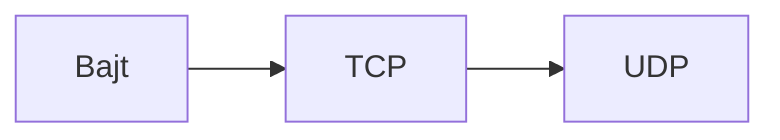
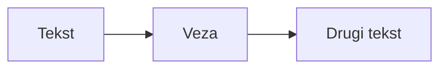
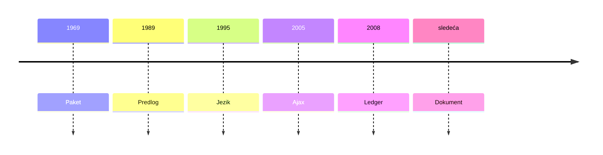

# Veb programiranje — lekcije i diskusija

Ovaj izvoz je stariji tok. Revidirani kurs je u `docs/kurs.xml` i `site/kurs.json`.

Elektronski fakultet, Univerzitet u Nišu. Oznaka MP.

Jedanaest nedelja, svaka po 90 minuta. Povezujući primer je kontrolna soba. Do pete nedelje panel živi u browseru, u `client/`. Od pete nedelje sluša Node proces iz `server/server.js`, a soba mašina stoji pored panela. Od osme nedelje režim i istorija ostaju u PostgreSQL-u. Nema stvarnog hardvera.

Ovaj fajl je nastavni tok iz `site/kurs.json`. Na sajtu časa iste dve celine stoje kao tabovi Gradivo i Diskusija. Ovde su **Lekcije** i **Diskusija**.

Obrazloženje je ovde otvoreno, da nastavnik ima ključ. Na projektoru odgovor ostaje neoznačen dok se obrazloženje ne otkrije. Opcija koja drži nosi reč **drži** uz razlog. Redosled opcija je isti kao na sajtu.

Preduslov prve nedelje: Još nema fajla. Priča počinje pre stranice. Preduslov svake sledeće nedelje je ishod prethodne. Na stranici časa te dve rečenice se ne prikazuju.

## Kako teče korak

Korak ide ovim redom: tekst, ključna ideja, zatim isečak ili crtež ako korak to ima, zatim kratka pitalica. Kratka pitalica nema tablu pretpostavki, nema fazu poređenja i nije druga polusatna diskusija.

Isečak je ono što korak pokazuje. Ako se taj prikaz razlikuje od reda koji ulazi u imenovani fajl, ispod stoji i taj red, pod natpisom „U fajl”. Koraci prve nedelje ne imenuju fajl.

Svaki korak nosi nivo Osnovno. Minuta uz korak je nastavna oznaka, ne tajmer. Zbir oznaka u nedelji može da pređe 90. Čas i dalje traje 90 minuta.

## Kako teče diskusija

Jedna diskusija pripada celoj nedelji. Sajt ne pamti glas. Nastavnik jedini pomera fazu, ovim redom:

1. **Izbor.** Opcije su vidljive i neoznačene. Podvlačenje trenutne većine ne otkriva koja opcija drži.
2. **Poređenje.** Razlozi u paru ili maloj grupi. Sajt i dalje ćuti o tačnom odgovoru.
3. **Pretpostavke.** Nastavnik upisuje čute rečenice, i one koje ne drže. Odgovor ostaje zatvoren.
4. **Analiza.** Svaka opcija dobije razlog i jedna bude označena. Upisana pogrešna pretpostavka ostaje.
5. **Ponovni izbor.** Podvlačenje sme da se pomeri. Upisuje se jedna zajednička rečenica.

Posle ponovnog izbora može da se otvori rezerva. Do tada je zatvorena i kreće opet od izbora. Nedelja 11 nema rezervno glasanje.

Izlaz je rečenica na poslednjem koraku. Nema opcija, pečata ni polja za upis.

Budžet razgovora je jedan za celu nedelju, oko 35 minuta, ne za svaku pitalicu koraka: izbor 3, poređenje 5, iznošenje razloga 8, analiza 7, ponovni izbor 5, rezerva ili još ista ideja 7. Ako grupa ostane bez zaključka, sledeća nedelja sme da krene istom pitalicom, pre novog gradiva.

## Mapa

| Nedelja | Naslov | Koraka | Pitanje diskusije |
| --- | --- | ---: | --- |
| [1](#nedelja-1) | Zašto je Web nastao | 20 | Ista reč „web” pokrije mrežu, stranicu iz 1991, Gmail i blockchain. Šta je stranica iz 1991. već bila? |
| [2](#nedelja-2) | Šta browser prikazuje | 19 | U alatima browsera „24 °C” postane „10 °C”. Šta je promenjeno? |
| [3](#nedelja-3) | JavaScript opisuje stanje | 12 | Objekat je u const, a druga promenljiva pokazuje na njega. Šta sme? |
| [4](#nedelja-4) | Događaji povezuju korisnika | 12 | Menjanje objekta menja tekst na stranici… |
| [5](#nedelja-5) | Od naivnog prenosa do HTTP-a, pa Node | 12 | Handler u Node-u pozove document i ugasi dugme. Šta se desi? |
| [6](#nedelja-6) | Čekanje i neuspeh | 12 | fetch je dobio HTTP 500. Da li je to catch? |
| [7](#nedelja-7) | Komande i ponavljanje | 12 | Koju komandu smemo da pošaljemo dvaput? |
| [8](#nedelja-8) | Trajno stanje i Docker | 12 | Režim je upisan, istorija nije. Da li je evidencija cela? |
| [9](#nedelja-9) | Koliko je prikaz svež | 12 | Displej kaže 24 °C, a očitavanje je staro deset minuta. Šta taj broj znači? |
| [10](#nedelja-10) | Ko sme da upravlja | 12 | Posmatrač nema dugme „Uključi”. Da li je server zaštićen? |
| [11](#nedelja-11) | Ceo sistem | 12 | Ekran kaže „uključeno”, odgovor nije stigao. Šta znamo? |

---

<a id="nedelja-1"></a>

## Nedelja 1 — Zašto je Web nastao

**Ishod.** Web je usluga na Internetu. Stranica je dokument. server/ još nema fajlove.

**Preduslov.** Još nema fajla. Priča počinje pre stranice.

**Trajanje.** 90 min · 20 koraka.

**Pitanje nedelje.** Ista reč „web” pokrije mrežu, stranicu iz 1991, Gmail i blockchain. Šta je stranica iz 1991. već bila?

### Lekcije

1. [LO](#n1-k1) · ~4 min
2. [Paket](#n1-k2) · ~4 min
3. [TCP i UDP](#n1-k3) · ~5 min
4. [Internet](#n1-k4) · ~4 min
5. [Hipertekst](#n1-k5) · ~5 min
6. [Predlog](#n1-k6) · ~4 min
7. [HTML](#n1-k7) · ~4 min
8. [W3C](#n1-k8) · ~4 min
9. [Rat browsera](#n1-k9) · ~5 min
10. [XML](#n1-k10) · ~4 min
11. [Deset dana](#n1-k11) · ~5 min
12. [ECMA](#n1-k12) · ~4 min
13. [Bez plugina](#n1-k13) · ~4 min
14. [Web 2.0](#n1-k14) · ~5 min
15. [Ajax](#n1-k15) · ~6 min
16. [Streaming](#n1-k16) · ~5 min
17. [Ekonomija](#n1-k17) · ~4 min
18. [Društvo](#n1-k18) · ~4 min
19. [Web 3.0](#n1-k19) · ~5 min
20. [Dokument](#n1-k20) · ~5 min

<a id="n1-k1"></a>

#### Korak 1. LO

~4 min · bez fajla

Zašto uopšte slati poruku ako veza može da pukne usred reči? 29. oktobra 1969. sa UCLA ka SRI stiže „LO”, pa sistem padne umesto „LOGIN”. To je mreža paketa. To nije Web.

> **Ključna ideja.** Mreža paketa iz 1969. još nema stranicu u browseru.

**Pitalica.** Šta je stiglo 29. oktobra 1969?

- A. To već jeste Web, jer je poruka stigla.
  Stigla su dva slova po mreži. Nema URL ni dokument u browseru.
- **B. Poruka iz 1969. nije Web.**
  **drži.** LO je mreža paketa. Web je povezani dokument, mnogo kasnije.

<a id="n1-k2"></a>

#### Korak 2. Paket

~4 min · bez fajla

Zašto seći poruku, umesto da se rezerviše veza od kraja do kraja? Ako je veza rezervisana, prekid ubije celu poruku. Paket ide drugim putem i poruka se sklopi.

> **Ključna ideja.** Prekinuta veza ne mora da ubije poruku.

**Pitalica.** Šta prekinuta veza uradi poruci od paketa?

- A. Ubije je, jer put je jedan.
  Paket ne traži jednu rezervisanu vezu.
- **B. Prekinuta veza ne mora da ubije poruku.**
  **drži.** Drugi paket može drugim putem. Poruka se sklopi na kraju.

<a id="n1-k3"></a>

#### Korak 3. TCP i UDP

~5 min · crtež, bez fajla

Ako kadar filma zakasni, da li čekamo bajt ili idemo dalje? TCP je pouzdan tok bajtova: dokument traži svaki bajt. UDP sme da odbaci datagram, pa glas, slika ili igra ne čekaju zakasneli kadar.

> **Ključna ideja.** Dokument čeka bajt. Zakasneli kadar sme da se odbaci.

**Crtež.**



**Pitalica.** Šta radimo sa zakasnelim kadrom?

- A. Čekamo ga, kao što dokument čeka bajt.
  Kadar koji zakasni više ne pripada slici koja je prošla.
- **B. Kadar sme da se odbaci, a dokument ne sme da izgubi bajt.**
  **drži.** TCP čuva svaki bajt dokumenta. UDP sme da odbaci glas ili sliku.

<a id="n1-k4"></a>

#### Korak 4. Internet

~4 min · bez fajla

Zašto jedan plan adresa za mnogo mreža? 1. januara 1983. mreže prelaze na TCP/IP. Taj dan zovu flag day. Internet je mreža mreža. Web još ne postoji.

> **Ključna ideja.** Flag day spaja mreže. Ne rađa stranicu.

**Pitalica.** Šta je mreža posle flag day 1983?

- A. To već jeste Web.
  1983. još nema predlog povezanih dokumenata.
- **B. Mreža iz 1983. nije Web.**
  **drži.** Internet je mreža mreža. Web stiže kao usluga na njoj.

<a id="n1-k5"></a>

#### Korak 5. Hipertekst

~5 min · crtež, bez fajla

Zašto pratiti ideju, umesto broja stranice? Bush 1945. opisuje Memex. Nelson 1965. kuje reč hipertekst. Veza je adresa drugog teksta, ne ukras na margini.

> **Ključna ideja.** Veza vodi na drugi tekst, ne na sledeći broj stranice.

**Crtež.**



**Pitalica.** Šta je veza u hipertekstu?

- A. Ukras koji browser sme da ignoriše.
  Veza je razlog što je tekst hipertekst.
- **B. Veza je adresa drugog teksta.**
  **drži.** Čitalac prati ideju. Ne okreće fiksni broj stranice.

<a id="n1-k6"></a>

#### Korak 6. Predlog

~4 min · bez fajla

Zašto je laboratoriji fizike uopšte trebalo ovo? Berners-Lee u CERN-u, marta 1989, predlaže povezane dokumente. Šef dopisuje „vague but exciting”. Web je jedna usluga na Internetu, ne sam Internet.

> **Ključna ideja.** Web je usluga. Internet je mreža ispod nje.

**Pitalica.** Šta je Web u odnosu na Internet?

- A. Web jeste cela mreža.
  Mreža već radi pre predloga iz 1989.
- **B. Web je jedna usluga na Internetu.**
  **drži.** Predlog rešava dokumente laboratorije, ne kablove.

<a id="n1-k7"></a>

#### Korak 7. HTML

~4 min · bez fajla

Zašto oznake koje čovek može da otkuca, a ne binarni raspored strane? 1991. izlazi prva javna stranica. Rane oznake nose strukturu: naslov, veza, spisak. Ne nose boju.

> **Ključna ideja.** Rana oznaka kaže šta je deo teksta, ne kako je ofarban.

**Pitalica.** Šta rana HTML oznaka imenuje?

- A. Boju i tačan raspored piksela.
  Boja stiže kasnije. Prva stranica je struktura.
- **B. Rani HTML imenuje strukturu, ne boju.**
  **drži.** Naslov, veza i spisak su uloge dela teksta.

<a id="n1-k8"></a>

#### Korak 8. W3C

~4 min · bez fajla

Ko odlučuje šta oznaka zna ako se browseri ne slažu? Berners-Lee 1994. osniva W3C da sledeća oznaka ne bude privatna reč jedne firme. To je preporuka, ne zakon jednog proizvođača.

> **Ključna ideja.** Značenje oznake nije vlasništvo jedne firme.

**Pitalica.** Čija je reč šta oznaka zna?

- A. One firme koja prva isporuči browser.
  Zato telo i postoji: da značenje ne ostane privatno.
- **B. Nijedan proizvođač ne poseduje značenje oznake.**
  **drži.** W3C drži preporuku koju browseri mogu da podele.

<a id="n1-k9"></a>

#### Korak 9. Rat browsera

~5 min · bez fajla

Šta se desi stranici kad svaki browser izmisli svoju oznaku? Netscape i Internet Explorer ratuju. Jedan ima blink, drugi marquee. Stranica piše „best viewed in” i puca u drugom browseru. Standard načas izgubi, pa opet postane potreban.

> **Ključna ideja.** Privatna oznaka radi samo tamo gde je izmišljena.

**Pitalica.** Zašto stranica puca u drugom browseru?

- A. Zato što W3C zabrani oba browsera.
  Puca oznaka koju drugi browser ne poznaje.
- **B. Stranica puca jer browseri izmišljaju svoje oznake.**
  **drži.** blink i marquee nisu isti jezik. Stranica traži jedan od njih.

<a id="n1-k10"></a>

#### Korak 10. XML

~4 min · bez fajla

Kako dva programa razmene zapis, a da se ne dogovore o ekranu? HTML ostaje hipertekst za čoveka. XML, 1998, jeste gramatika stabla podataka. Program čita zapis. Ne crta stranicu.

> **Ključna ideja.** XML nosi stablo zapisa. HTML nosi tekst za čoveka.

**Pitalica.** Šta XML nosi između dva programa?

- A. Raspored stranice koji browser mora da nacrta.
  Ekran nije ugovor između programa.
- **B. XML nosi zapis, ne raspored stranice.**
  **drži.** Dva programa slože stablo. Ne slože prozor.

<a id="n1-k11"></a>

#### Korak 11. Deset dana

~5 min · bez fajla

Zašto jezik u dokumentu, ako je stranica već stigla? Maja 1995. Brendan Eich napiše jezik za deset dana. Imena idu Mocha, pa LiveScript, pa JavaScript, jer se Java reklamirala. To nije Java.

> **Ključna ideja.** Ime je reklamni susret. Jezik nije Java.

**Pitalica.** Da li je JavaScript isto što i Java?

- A. Jeste. Ime kaže da je u pitanju Java.
  Ime je došlo iz reklame. Jezik je drugi.
- **B. Jezik nije Java.**
  **drži.** Deset dana u browseru nisu Java. Mocha i LiveScript su ranija imena.

<a id="n1-k12"></a>

#### Korak 12. ECMA

~4 min · bez fajla

Čije je ime jezika ako ga isporučuju dva browsera? JavaScript je žig. Standard ECMA-262 iz 1997. zove jezik ECMAScript. ES3, ES5 i ES6 su ista reč u različitim godinama.

> **Ključna ideja.** Standard nosi drugo ime jer je JavaScript žig.

**Pitalica.** Kako se zove standard jezika?

- A. Java, jer je žig dovoljan.
  Žig nije tekst standarda.
- **B. Ime standarda je ECMAScript.**
  **drži.** ECMA-262 drži jezik. ES3, ES5 i ES6 su godine te iste reči.

<a id="n1-k13"></a>

#### Korak 13. Bez plugina

~4 min · bez fajla

Šta plugin traži od čoveka, a skripta u stranici ne traži? Aplet, Flash i Silverlight traže da se nešto instalira. Jezik u stranici je već u browseru. Zato ostaje.

> **Ključna ideja.** Pobedio je jezik koji ne traži instalaciju.

**Pitalica.** Zašto je jezik u stranici ostao, a plugin nije?

- A. Zato što je plugin brži.
  Brzina plugina ne skida instalaciju.
- **B. Jezik je pobedio jer je već u stranici.**
  **drži.** Aplet, Flash i Silverlight traže plugin. Skripta je već tu.

<a id="n1-k14"></a>

#### Korak 14. Web 2.0

~5 min · bez fajla

Ko je autor ako čitalac sme da menja stranicu? DiNucci 1999. kuje ime Web 2.0. O'Reilly ga 2004. proširi. Wikipedia od 2001. i blog daju pero čitaocu. Stranica više nije samo objavljen dokument.

> **Ključna ideja.** Čitalac postaje autor kad stranica primi njegov upis.

**Pitalica.** Ko piše stranicu u Web 2.0?

- A. Samo redakcija koja je stranicu objavila.
  Redakcija više nije jedini autor.
- **B. Čitalac može da menja stranicu.**
  **drži.** Blog i Wikipedia puštaju upis onoga ko čita.

<a id="n1-k15"></a>

#### Korak 15. Ajax

~6 min · bez fajla

Zašto mapa ne učita novi dokument kad je povučeš? Garrett februara 2005. imenuje obrazac. Gmail i Google Maps ostave dokument na mestu, a zahtev promeni deo. Veb aplikacija nije prezentacioni sajt.

> **Ključna ideja.** Dokument ostaje. Zahtev menja deo, ne celu stranu.

**Pitalica.** Šta Ajax uradi stranici?

- A. Zameni ceo dokument novim fajlom.
  Mapa se vuče bez nove strane.
- **B. Dokument ostaje, a zahtev menja deo.**
  **drži.** Gmail i Maps ne učitavaju novu stranu za svaki pokret.

<a id="n1-k16"></a>

#### Korak 16. Streaming

~5 min · bez fajla

Šta video-klub prodaje kad film krene pre nego što stigne ceo? YouTube 2005. i Netflix, koji silazi sa diska, puste sliku pre kraja fajla. Zakasneli kadar sme da se odbaci, kao UDP. Prenos novca ne sme da izgubi bajt, kao TCP.

> **Ključna ideja.** Film sme da krene pre poslednjeg bajta. Uplata ne sme.

**Pitalica.** Kad sme reprodukcija da krene?

- A. Tek kad ceo fajl stigne, kao disk u ruci.
  Disk je morao da stigne. Tok ne mora.
- **B. Reprodukcija može da krene pre nego što stigne ceo fajl.**
  **drži.** Zakasneli kadar se odbaci. Bajta uplate se ne odbacuje.

<a id="n1-k17"></a>

#### Korak 17. Ekonomija

~4 min · bez fajla

Zašto stranica stigne do kupca do koga radnja na uglu ne stiže? Kopija više nema cenu štampe. Oglas u novinama umre ujutru. Lista na stranici ostane.

> **Ključna ideja.** Stranica dosegne kupca kome radnja na uglu ne dosegne.

**Pitalica.** Šta stranica uradi oglasu koji novine ugase ujutru?

- A. I ona ugasi oglas u ponoć.
  Cena štampe više ne gasi listu.
- **B. Stranica stiže do kupca do koga radnja na uglu ne stiže.**
  **drži.** Lista ostane. Novinski oglas ne ostane.

<a id="n1-k18"></a>

#### Korak 18. Društvo

~4 min · bez fajla

Šta je štamparija odbijala, a obrazac objavljuje? 1993. AOL otvori Usenet i klub postane grad. To zovu Eternal September. Britannica 2012. ugasi štampu posle Wikipedije. Oskudan postane pažnja, ne papir.

> **Ključna ideja.** Objava više ne čeka kapiju štamparije.

**Pitalica.** Šta obrazac uradi tekstu koji štamparija ne bi pustila?

- A. Vrati ga uredniku da čeka hartiju.
  Hartija više nije kapija.
- **B. Objava više ne čeka štampariju.**
  **drži.** Eternal September i kraj štampe Britannice su isti pomak: tekst izađe bez štamparije.

<a id="n1-k19"></a>

#### Korak 19. Web 3.0

~5 min · bez fajla

Čijem ledgeru veruješ ako ne veruješ ledgeru banke? Ime Web 3.0 prvo znači semantički web, a kasnije blockchain. White paper iz oktobra 2008. nudi ledger koji drži više strana. Taj ledger nije novi Internet. Stranica i dalje traži browser.

> **Ključna ideja.** Ledger više strana nije nova mreža.

**Pitalica.** Šta blockchain nije?

- A. Novi Internet, umesto mreže iz 1983.
  Stranica i dalje ide browserom preko Interneta.
- **B. Ledger nije novi Internet.**
  **drži.** Ledger menja ko drži zapis. Ne menja mrežu ni browser.

<a id="n1-k20"></a>

#### Korak 20. Dokument

~5 min · crtež, bez fajla

Šta od ove nedelje sledeća stranica još nema? Imaće dokument. Još nema jezik u stranici, zahtev koji menja deo, ni server. server/ je i dalje prazan.

> **Ključna ideja.** Sledeća nedelja piše dokument. Ostalo čeka svoje časove.

**Crtež.**



**Pitalica.** Šta sledeća nedelja piše?

- A. Server, jezik i Ajax odjednom.
  To su kasniji časovi. server/ je prazan.
- **B. Sledeća nedelja piše dokument.**
  **drži.** Jezik, delimičan zahtev i server još nisu na stranici.

### Pojmovi časa

**Hipertekst.** tekst čija veza vodi na drugi tekst

Veza je adresa drugog teksta. Čitalac prati ideju, ne broj stranice.

`Tekst → Veza → Drugi tekst`

**TCP.** tok koji čeka svaki bajt

TCP je pouzdan tok bajtova. Dokument ne sme da izgubi bajt.

`bajt, bajt, bajt → dokument`

**UDP.** datagram koji sme da se odbaci

UDP sme da odbaci zakasneli kadar. Glas i slika ne čekaju taj bajt.

`kadar koji zakasni → odbaci`

**HTML.** oznake strukture za čoveka

Rani HTML imenuje naslov, vezu i spisak. Ne imenuje boju.

`<h1>naslov</h1>`

**XML.** stablo zapisa između programa

XML nosi zapis. Dva programa ne moraju da se dogovore o ekranu.

`<zapis>24</zapis>`

**ECMAScript.** ime standarda, ne žig

JavaScript je žig. ECMA-262 zove jezik ECMAScript. ES3, ES5 i ES6 su godine.

`ECMA-262`

**Ajax.** zahtev koji menja deo dokumenta

Dokument ostaje. Zahtev promeni deo. To je veb aplikacija, ne prezentacioni sajt.

```text
dokument ostaje
zahtev menja deo
```

**W3C.** telo koje drži značenje oznake

W3C postoji da značenje oznake ne bude privatna reč jedne firme.

`oznaka → preporuka`

### Diskusija

**Problem.** Ista reč „web” pokrije mrežu, stranicu iz 1991, Gmail i blockchain. Šta je stranica iz 1991. već bila?

**Pretpostavka koja se često čuje.** Web, Internet, aplikacija i blockchain su isto, samo noviji naziv.

Faze: Izbor, Poređenje, Pretpostavke, Analiza, Ponovni izbor. Razlozi se otvaraju tek u analizi.

#### Glavna pitalica

- A. Mreža kojom poruka uopšte stiže.
  Mreža je Internet. Stranica iz 1991. nije mreža.
- **B. Hipertekstni dokument koji browser dovuče po URL-u.**
  **drži.** To nije mreža, nije aplikacija i nije blockchain. Dokument se dovuče po URL-u.
- C. Aplikacija kao Gmail, jer se stranica već osvežava u delu.
  Aplikacija stiže kad zahtev menja deo. Stranica iz 1991. to još nije.
- D. Ledger koji drži više strana.
  Ledger je kasniji odgovor na pitanje ko drži zapis. Nije stranica iz 1991.

#### Rezerva

Zatvorena dok je nastavnik ne otvori, posle ponovnog izbora. Kreće opet od izbora.

**Problem.** Kadar filma zakasni. Da li čekamo taj bajt?

- A. Čekamo ga, jer je svaki bajt deo dokumenta.
  Dokument čeka bajt. Kadar koji zakasni više nije ovaj trenutak slike.
- **B. Kadar sme da se odbaci, a dokument ne sme da izgubi bajt.**
  **drži.** UDP sme da odbaci kadar. TCP ne sme da izgubi bajt dokumenta.
- C. Odbacimo i kadar i bajt dokumenta, jer je mreža ista.
  Ista mreža nosi oba. Pravilo čekanja nije isto.

#### Izlaz

Rečenica na poslednjem koraku. Nema opcija, pečata ni polja.

> Šta je hipertekst, po čemu TCP nije UDP, i šta Ajax doda a prva stranica nema?

---

<a id="nedelja-2"></a>

## Nedelja 2 — Šta browser prikazuje

**Ishod.** Dokument, prikaz i merenje nisu ista stvar.

**Preduslov.** Web je usluga na Internetu. Stranica je dokument. server/ još nema fajlove.

**Trajanje.** 90 min · 19 koraka.

**Pitanje nedelje.** U alatima browsera „24 °C” postane „10 °C”. Šta je promenjeno?

### Lekcije

1. [Podela](#n2-k1) · ~6 min
2. [Stranica](#n2-k2) · ~6 min
3. [Glava](#n2-k3) · ~4 min
4. [Telo](#n2-k4) · ~4 min
5. [Naslov](#n2-k5) · ~4 min
6. [Broj](#n2-k6) · ~4 min
7. [Dugme](#n2-k7) · ~4 min
8. [Veza](#n2-k8) · ~4 min
9. [Selektor](#n2-k9) · ~4 min
10. [Okvir](#n2-k10) · ~4 min
11. [Unutra](#n2-k11) · ~4 min
12. [Spolja](#n2-k12) · ~4 min
13. [Promenljiva](#n2-k13) · ~4 min
14. [Calc](#n2-k14) · ~4 min
15. [Osvežavanje](#n2-k15) · ~6 min
16. [Alati](#n2-k16) · ~6 min
17. [Dva zahteva](#n2-k17) · ~6 min
18. [Soba prekidača](#n2-k18) · ~6 min
19. [Semantika](#n2-k19) · ~6 min

<a id="n2-k1"></a>

#### Korak 1. Podela

~6 min · `client/index.html`

Dva foldera stoje jedan pored drugog pre ijedne funkcije.

> **Ključna ideja.** client/ je ono što browser učita. server/ još nema fajlove.

**Pitalica.** Šta browser učitava na ovom času?

- A. Oba foldera odjednom.
  Server još ne radi.
- **B. client/. server/ je prazno mesto.**
  **drži.** Browser učitava klijent. Server čeka Node.

<a id="n2-k2"></a>

#### Korak 2. Stranica

~6 min · `client/index.html`

Stranica počinje praznim dokumentom, ne panelom.

> **Ključna ideja.** Element html i atribut lang otvaraju dokument.

**Isečak.** Stranica

```html
<!DOCTYPE html>
<html lang="sr">
</html>
```

**Pitalica.** Šta je ovaj fajl?

- A. Naredba koju Node pokreće.
  Node se na ovom času ne pokreće.
- **B. HTML dokument koji browser učita.**
  **drži.** Ovo je dokument, ne proces.

<a id="n2-k3"></a>

#### Korak 3. Glava

~4 min · `client/index.html`

Charset i naslov dokumenta stoje u glavi, pre sadržaja.

> **Ključna ideja.** Element head nosi charset i title. Još nema onoga što se vidi u sobi.

**Isečak.** Glava

```html
<meta charset="utf-8">
<title>Soba</title>
```

**U fajl.**

```html
<head>
<meta charset="utf-8">
<title>Soba</title>
</head>
```

**Pitalica.** Gde stoje charset i title?

- A. U merenju temperature.
  Merenja još nema.
- **B. U glavi dokumenta.**
  **drži.** head nosi opis dokumenta.

<a id="n2-k4"></a>

#### Korak 4. Telo

~4 min · `client/index.html`

Telo je prazno mesto za ono što će soba prikazati.

> **Ključna ideja.** Element body drži sadržaj. Stil i komanda još nisu tu.

**Isečak.** Telo

```html
<body>
</body>
```

**Pitalica.** Šta je body na ovom koraku?

- A. Stil broja.
  Stil je poseban fajl.
- **B. Prazno mesto za sadržaj.**
  **drži.** Sadržaj dolazi u telo.

<a id="n2-k5"></a>

#### Korak 5. Naslov

~4 min · `client/index.html`

Naslov je deo dokumenta, ne merenje.

> **Ključna ideja.** Element h1 je naslov, ne pasus.

**Isečak.** Naslov

```html
<h1>Soba prekidača</h1>
```

**Pitalica.** Osvežavanje stranice...

- A. Zaboravlja naslov.
  Naslov je u fajlu.
- **B. Ponovo učita naslov iz fajla.**
  **drži.** Dokument se čita iznova.

<a id="n2-k6"></a>

#### Korak 6. Broj

~4 min · `client/index.html`

U pasusu stoji broj, kao običan tekst.

> **Ključna ideja.** Element p i atribut class drže 24.

**Isečak.** Broj

```html
<p class="digit">24</p>
```

**Pitalica.** Odakle je 24 na početku?

- A. Iz merenja kutije.
  Kutije još nema.
- **B. Iz statičnog teksta dokumenta.**
  **drži.** 24 je sadržaj HTML-a.

<a id="n2-k7"></a>

#### Korak 7. Dugme

~4 min · `client/index.html`

Dugme je element dokumenta. Još ništa ne šalje.

> **Ključna ideja.** Element button i atribut type jesu u dokumentu. Komanda dolazi tek kad postoji server.

**Isečak.** Dugme

```html
<button type="button">Uključi</button>
```

**Pitalica.** Klik na ovo dugme na času 1...

- A. Šalje komandu ventilatoru.
  Ventilatora i servera još nema.
- **B. Ne menja dokument.**
  **drži.** Dugme još nema ponašanje.

<a id="n2-k8"></a>

#### Korak 8. Veza

~4 min · `client/index.html`

Dokument kaže browseru gde je stil.

> **Ključna ideja.** Element link i atribut href učitavaju stil. Broj i dalje stoji u HTML-u.

**Isečak.** Veza

```html
<link rel="stylesheet" href="css/soba.css">
```

**Pitalica.** Šta ova veza radi?

- A. Šalje komandu ventilatoru.
  Ovo je veza ka stilu, ne komanda.
- **B. Traži da browser učita stil.**
  **drži.** href pokazuje na css fajl.

<a id="n2-k9"></a>

#### Korak 9. Selektor

~4 min · `client/css/soba.css`

Klasa bira broj, ne ceo dokument.

> **Ključna ideja.** Klasni selektor .digit bira broj. Dokument i dalje kaže 24.

**Isečak.** Selektor

```css
letter-spacing: 0.08em;
```

**Pitalica.** Šta .digit bira?

- A. Svaki element na stranici.
  Tačka bira klasu, ne sve elemente.
- **B. Element sa klasom digit.**
  **drži.** Selektor .digit gleda atribut class.

<a id="n2-k10"></a>

#### Korak 10. Okvir

~4 min · `client/css/soba.css`

Kutija dobija ivicu.

> **Ključna ideja.** border je ivica kutije. Broj u fajlu i dalje je 24.

**Isečak.** Okvir

```css
border: 1px solid #3a342c;
```

**Pitalica.** Šta border menja?

- A. Broj 24 u dokumentu.
  Broj ostaje u HTML-u.
- **B. Ivicu kutije.**
  **drži.** border je deo box modela.

<a id="n2-k11"></a>

#### Korak 11. Unutra

~4 min · `client/css/soba.css`

Unutar ivice ostaje prazan prostor.

> **Ključna ideja.** padding je prostor unutar ivice.

**Isečak.** Unutra

```css
padding: 1rem;
```

**Pitalica.** Gde je padding?

- A. Van ivice, prema susedima.
  To je margin.
- **B. Unutar ivice, oko sadržaja.**
  **drži.** padding je unutrašnji razmak.

<a id="n2-k12"></a>

#### Korak 12. Spolja

~4 min · `client/css/soba.css`

Van ivice kutija se odmiče.

> **Ključna ideja.** margin je prostor van ivice.

**Isečak.** Spolja

```css
margin: 1rem;
```

**Pitalica.** Gde je margin?

- A. Unutar ivice.
  To je padding.
- **B. Van ivice.**
  **drži.** margin odmiče kutiju od suseda.

<a id="n2-k13"></a>

#### Korak 13. Promenljiva

~4 min · `client/css/soba.css`

Dužina broja dobija ime u stilu.

> **Ključna ideja.** Ime --broj drži 2rem. var(--broj) čita to ime.

**Isečak.** Promenljiva

```css
--broj: 2rem;
font-size: var(--broj);
```

**Pitalica.** Šta čita var(--broj)?

- A. Broj 24 iz HTML-a.
  24 je sadržaj dokumenta.
- **B. Ime --broj iz stila.**
  **drži.** var čita CSS ime.

<a id="n2-k14"></a>

#### Korak 14. Calc

~4 min · `client/css/soba.css`

Ista imenovana dužina može da se izračuna.

> **Ključna ideja.** calc množi imenovanu dužinu. Broj 24 u dokumentu ostaje.

**Isečak.** Calc

```css
font-size: calc(var(--broj) * 2);
```

**Pitalica.** Šta calc menja?

- A. Tekst 24 u fajlu.
  Dokument se ne dira.
- **B. Veličinu broja u stilu.**
  **drži.** calc računa dužinu, ne sadržaj.

<a id="n2-k15"></a>

#### Korak 15. Osvežavanje

~6 min · `client/index.html`

U alatima je neko prekucao 24 u 10.

> **Ključna ideja.** Osvežavanje vraća dokument. 10 je bio samo lokalni prikaz.

**Isečak.** Osvežavanje

```html
<!-- osvežavanje vraća dokument -->
```

**Pitalica.** Šta osvežavanje uradi?

- A. Upisuje 10 u fajl.
  Alati nisu sačuvali fajl.
- **B. Vraća dokument, opet 24.**
  **drži.** Prikaz se pravi iznova iz fajla.

<a id="n2-k16"></a>

#### Korak 16. Alati

~6 min · `client/index.html`

Izmena u alatima vidi se odmah na ekranu.

> **Ključna ideja.** Alati menjaju sliku u ovom browseru. Dokument ostaje.

**Isečak.** Alati

```text
element.textContent = "10"
```

**U fajl.**

```html
<!-- prikaz može da kaže 10; fajl i dalje kaže 24 -->
```

**Pitalica.** Šta je time promenjeno?

- A. Merenje.
  Merenje nismo dirali.
- **B. Lokalni prikaz, ne dokument.**
  **drži.** Fajl i dalje kaže 24.
- C. I merenje i dokument.
  Dokument se nije sačuvao.

<a id="n2-k17"></a>

#### Korak 17. Dva zahteva

~6 min · `client/index.html`

Stranica traži dokument, pa stil.

> **Ključna ideja.** Network pokazuje dokument i stil. Čitanje sobe još ne postoji.

**Isečak.** Dva zahteva

```text
GET /
GET /css/soba.css
```

**U fajl.**

```html
<!-- nema /api/soba -->
```

**Pitalica.** Da li se vidi zahtev za sobu?

- A. Da, inače broj ne bi postojao.
  Broj je u dokumentu.
- **B. Ne. Nema zahteva za API sobe.**
  **drži.** Stižu dokument i stil.

<a id="n2-k18"></a>

#### Korak 18. Soba prekidača

~6 min · `client/index.html`

Na ekranu je jedna soba i jedan broj.

> **Ključna ideja.** Čas 1 crta samo sobu prekidača. Lopatice nisu deo ovog prikaza.

**Isečak.** Soba prekidača

```text
soba prekidača
24
```

**U fajl.**

```html
<!-- samo soba prekidača -->
```

**Pitalica.** Gde je ventilator?

- A. U sobi prekidača, mali.
  Lopatica još nema.
- **B. Nigde. Soba mašina se ne crta.**
  **drži.** Crta se samo soba prekidača.

<a id="n2-k19"></a>

#### Korak 19. Semantika

~6 min · `client/index.html`

Naslov nije podebljan pasus.

> **Ključna ideja.** Semantički HTML ostaje i kad se stil promeni.

**Isečak.** Semantika

```html
<!-- naslov je h1, ne pasus -->
```

**Pitalica.** Zašto h1, a ne samo velika slova?

- A. Zato što server tako čita temperaturu.
  Server se na ovom času ne pokreće.
- **B. Zato što dokument kaže šta je naslov.**
  **drži.** h1 imenuje naslov.

### Pojmovi časa

**Prikaz.** ono što ovaj browser crta

Prikaz je slika dokumenta u jednom browseru. Izmena u alatima ostaje u toj slici.

```html
<p>24</p>
<!-- alati pokažu 10, dokument i dalje kaže 24 -->
```

**Dokument.** HTML koji stigne

Dokument je HTML koji browser učita. Iz prikaza se ne šalje nazad.

```html
GET /

<p class="digit">24</p>
```

**CSS.** izgled istog dokumenta

CSS opisuje izgled. Ime u stilu i calc računaju dužinu. Ako stil ne stigne, sadržaj i dalje može da se pročita.

```text
:root {
  --broj: 2rem;
}

.digit {
  font-size: calc(var(--broj) * 2);
}
```

### Diskusija

**Problem.** U alatima browsera „24 °C” postane „10 °C”. Šta je promenjeno?

**Pretpostavka koja se često čuje.** Ekran jeste stanje kutije.

Faze: Izbor, Poređenje, Pretpostavke, Analiza, Ponovni izbor. Razlozi se otvaraju tek u analizi.

#### Glavna pitalica

- A. Merenje temperature.
  Merenje nismo dirali. Broj na ekranu nije nova temperatura.
- B. HTML dokument.
  Nema zahteva koji menja dokument. Osvežavanje vraća 24.
- **C. Lokalni prikaz u ovom browseru.**
  **drži.** Alati menjaju sliku u ovom browseru. Osvežavanje vraća dokument sa 24.
- D. I merenje i dokument, jer ekran jeste stanje kutije.
  Ekran nije stanje kutije. Osvežavanje vraća dokument.

#### Rezerva

Zatvorena dok je nastavnik ne otvori, posle ponovnog izbora. Kreće opet od izbora.

**Problem.** HTML je stigao, CSS nije. Šta ostaje na strani?

- **A. Sadržaj može ostati vidljiv bez očekivanog izgleda.**
  **drži.** Stil opisuje izgled. Dokument i dalje nosi tekst.
- B. Bez CSS-a stranica je prazna.
  Browser i dalje prikaže sadržaj dokumenta.
- C. CSS jeste dokument, pa ništa nije stiglo.
  Dokument i stil su dva zahteva.

#### Izlaz

Rečenica na poslednjem koraku. Nema opcija, pečata ni polja.

> Gde je dokument, gde je prikaz, a šta osvežavanje vraća?

---

<a id="nedelja-3"></a>

## Nedelja 3 — JavaScript opisuje stanje

**Ishod.** Objekat drži temperaturu. Ekran je još ne crta.

**Preduslov.** Dokument, prikaz i merenje nisu ista stvar.

**Trajanje.** 90 min · 12 koraka.

**Pitanje nedelje.** Objekat je u const, a druga promenljiva pokazuje na njega. Šta sme?

### Lekcije

1. [Objekat](#n3-k1) · ~8 min
2. [const](#n3-k2) · ~8 min
3. [Drugo ime](#n3-k3) · ~8 min
4. [Nova dodela](#n3-k4) · ~8 min
5. [Delta](#n3-k5) · ~8 min
6. [Prekidač uključen](#n3-k6) · ~8 min
7. [Konzola](#n3-k7) · ~8 min
8. [filter](#n3-k8) · ~8 min
9. [map](#n3-k9) · ~8 min
10. [reduce](#n3-k10) · ~8 min
11. [Prag](#n3-k11) · ~8 min
12. [Tip](#n3-k12) · ~8 min

<a id="n3-k1"></a>

#### Korak 1. Objekat

~8 min · `client/js/korak.js`

Stanje stane u jedan objekat, pre bilo kog ekrana.

> **Ključna ideja.** Objekat drži temperaturu i željeno stanje prekidača.

**Isečak.** Objekat

```javascript
const soba = { temperatura: 24, zeljeno: false };
```

**Pitalica.** Gde je temperatura?

- A. U natpisu na dugmetu.
  Ekran je još ne čita objekat.
- **B. U polju objekta.**
  **drži.** Objekat drži broj.

<a id="n3-k2"></a>

#### Korak 2. const

~8 min · `client/js/korak.js`

Ime je vezano. Polje nije.

> **Ključna ideja.** const ne zamrzava objekat.

**Isečak.** const

```javascript
const soba = { temperatura: 24 };
soba.temperatura = 25;
```

**U fajl.**

```text
soba.temperatura = 25;
```

**Pitalica.** Šta const brani?

- A. Svaku izmenu polja.
  Polje i dalje sme da se menja.
- **B. Novu dodelu tog imena.**
  **drži.** soba = {} ne prolazi. soba.temperatura = 25 prolazi.

<a id="n3-k3"></a>

#### Korak 3. Drugo ime

~8 min · `client/js/korak.js`

Dva imena mogu pokazivati na isti objekat.

> **Ključna ideja.** Izmena kroz jedno ime vidi se kroz drugo.

**Isečak.** Drugo ime

```javascript
const drugo = soba;
drugo.temperatura = 26;
```

**U fajl.**

```javascript
const drugo = soba;
```

**Pitalica.** Šta drugo vidi?

- A. Kopiju, pa soba ostaje 24.
  Nema kopije objekta.
- **B. Isti objekat, pa se vidi 26.**
  **drži.** Dodela kopira referencu.

<a id="n3-k4"></a>

#### Korak 4. Nova dodela

~8 min · `client/js/korak.js`

Ime const ne sme da pokaže na drugi objekat.

> **Ključna ideja.** Nova dodela imena ne prolazi. Polje je i dalje slobodno.

**Isečak.** Nova dodela

```text
soba = { temperatura: 24 };
```

**U fajl.**

```javascript
// soba = { temperatura: 24 } ne prolazi
```

**Pitalica.** Šta se desi?

- A. Polje se vrati na 24.
  Ovo nije izmena polja.
- **B. Dodela imena ne prolazi.**
  **drži.** const brani novo vezivanje imena.

<a id="n3-k5"></a>

#### Korak 5. Delta

~8 min · `client/js/korak.js`

Jedna funkcija diže broj za fiksnu deltu.

> **Ključna ideja.** Sledeći korak uveća temperaturu za deltu i ne gleda prekidač.

**Isečak.** Delta

```javascript
let delta = 1;
function korak(soba) {
  soba.temperatura += delta;
}
```

**U fajl.**

```javascript
function korak(soba) {
  soba.temperatura += delta;
}
```

**Pitalica.** Da li funkcija gleda prekidač?

- A. Da, inače bi ventilator uticao.
  Režim ne ulazi u računicu.
- **B. Ne. Uvek doda deltu.**
  **drži.** Željeno stanje se ignoriše.

<a id="n3-k6"></a>

#### Korak 6. Prekidač uključen

~8 min · `client/js/korak.js`

Prekidač je na uključeno, pa se zove korak.

> **Ključna ideja.** Sledeći poziv daje višu temperaturu i kad je prekidač na uključeno.

**Isečak.** Prekidač uključen

```text
soba.zeljeno = true;
korak(soba);
```

**U fajl.**

```text
korak(soba);
```

**Pitalica.** Šta konzola vidi?

- A. Isti broj, jer je prekidač uključen.
  Delta ne pita prekidač.
- **B. Broj veći za deltu.**
  **drži.** Računica je uvek ista.

<a id="n3-k7"></a>

#### Korak 7. Konzola

~8 min · `client/js/korak.js`

Broj se prati ispisom, ne na displeju.

> **Ključna ideja.** Vrednosti se prate u konzoli. DOM se ne vezuje.

**Isečak.** Konzola

```text
console.log(soba.temperatura);
```

**Pitalica.** Šta ekranski broj uradi?

- A. Prati konzolu.
  Crtanja još nema.
- **B. Ostaje. Konzola je drugi izlaz.**
  **drži.** Displej čeka čas 3.

<a id="n3-k8"></a>

#### Korak 8. filter

~8 min · `client/js/niz.js`

Niz tačaka bira one iznad praga.

> **Ključna ideja.** filter radi jednu stvar: bira tačke.

**Isečak.** filter

```javascript
function iznadPraga(tacke) {
  return tacke.filter((t) => t.temperatura >= 24);
}
```

**U fajl.**

```javascript
function iznadPraga(tacke) {
  return tacke.filter((tacka) => tacka.temperatura >= 24);
}
```

**Pitalica.** Šta filter vrati?

- A. Jedan broj, prosek.
  Prosek je reduce.
- **B. Nov niz tačaka koje prolaze.**
  **drži.** filter bira, ne crta.

<a id="n3-k9"></a>

#### Korak 9. map

~8 min · `client/js/niz.js`

Od tačke ostane visina.

> **Ključna ideja.** map vadi visinu. Petlja ostaje za crtanje, kasnije.

**Isečak.** map

```javascript
function temperature(tacke) {
  return tacke.map((t) => t.temperatura);
}
```

**U fajl.**

```javascript
function temperature(tacke) {
  return tacke.map((tacka) => tacka.temperatura);
}
```

**Pitalica.** Šta map promeni?

- A. Iste tačke, samo sakrije niske.
  To radi filter.
- **B. Svaku tačku pretvori u broj.**
  **drži.** Izlaz je niz visina.

<a id="n3-k10"></a>

#### Korak 10. reduce

~8 min · `client/js/niz.js`

Visine se saberu u jedan broj.

> **Ključna ideja.** Konzola ispiše visine i prosek. Taj niz još ne crta displej.

**Isečak.** reduce

```javascript
function prosek(visine) {
  const zbir = visine.reduce((s, v) => s + v, 0);
  return visine.length ? zbir / visine.length : 0;
}
```

**U fajl.**

```javascript
const zbir = visine.reduce((s, v) => s + v, 0);
```

**Pitalica.** Šta reduce vrati?

- A. Niz, kao map.
  reduce skuplja u jednu vrednost.
- **B. Jednu vrednost, ovde prosek.**
  **drži.** Zbir pa deljenje.

<a id="n3-k11"></a>

#### Korak 11. Prag

~8 min · `client/js/niz.js`

Jedna izmena menja koji redovi ostanu.

> **Ključna ideja.** Editor sme da promeni prag filtera. Ekranski broj i dalje stoji.

**Isečak.** Prag

```text
tacka.temperatura >= prag
```

**U fajl.**

```javascript
const prag = 24;
```

**Pitalica.** Ako prag poraste, prosek...

- A. Uvek ostane isti.
  Manje tačaka uđe u sabiranje.
- **B. Računa se iz tačaka iznad novog praga.**
  **drži.** filter bira pre reduce.

<a id="n3-k12"></a>

#### Korak 12. Tip

~8 min · `client/js/korak.js`

Broj i tekst istog zapisa nisu ista vrednost.

> **Ključna ideja.** Rezervna provera je strogo poređenje broja i teksta temperature.

**Isečak.** Tip

```text
24 === "24"
```

**U fajl.**

```text
24 === "24" // false
```

**Pitalica.** Šta === kaže?

- A. Tačno, oba su 24.
  Strogo poređenje ne pretvara tip.
- **B. Netačno. Broj nije tekst.**
  **drži.** Jedna promena: kopija polja u novi objekat više ne prati izmenu.

### Pojmovi časa

**const.** ime se ne dodeljuje ponovo

const vezuje ime. Polje objekta i dalje sme da se promeni.

```javascript
const soba = { temperatura: 24 };
soba.temperatura = 25;
```

**Referenca.** dva imena, isti objekat

Dodela objekta kopira referencu. Izmena kroz jedno ime vidi se kroz drugo.

```javascript
const a = { temperatura: 24 };
const b = a;
b.temperatura = 25;
```

**map, filter, reduce.** niz tačaka, bez petlje

iznadPraga bira tačke, temperature vadi visinu, prosek sabira. Svaka funkcija radi jednu stvar.

```javascript
function iznadPraga(tacke) {
  return tacke.filter((tacka) => tacka.temperatura >= 24);
}
```

### Diskusija

**Problem.** Objekat je u const, a druga promenljiva pokazuje na njega. Šta sme?

**Pretpostavka koja se često čuje.** const zamrzava objekat, ili drugo ime pravi kopiju.

Faze: Izbor, Poređenje, Pretpostavke, Analiza, Ponovni izbor. Razlozi se otvaraju tek u analizi.

#### Glavna pitalica

- **A. Polje sme da se menja, i drugo ime vidi istu izmenu.**
  **drži.** const drži ime, ne zamrzava polja. Drugo ime nije kopija.
- B. const zamrzne objekat.
  Zabrana važi za novu dodelu imena, ne za polje.
- C. Drugo ime pravi kopiju.
  Oba imena pokazuju na isti objekat.
- D. Polje sme da se menja samo uz let.
  let nije uslov za izmenu polja.

#### Rezerva

Zatvorena dok je nastavnik ne otvori, posle ponovnog izbora. Kreće opet od izbora.

**Problem.** temperatura === "24" kad je u objektu broj 24. Šta važi?

- **A. Strogo poređenje je netačno. Tekst i broj nisu isti tip.**
  **drži.** === ne pretvara tip.
- B. Uvek je tačno, jer oba izgledaju kao 24.
  Izgled na ekranu nije tip vrednosti.

#### Izlaz

Rečenica na poslednjem koraku. Nema opcija, pečata ni polja.

> Šta const drži, a šta polje objekta sme?

---

<a id="nedelja-4"></a>

## Nedelja 4 — Događaji povezuju korisnika

**Ishod.** Klik menja stanje. Poseban kod crta prikaz.

**Preduslov.** Objekat drži temperaturu. Ekran je još ne crta.

**Trajanje.** 90 min · 12 koraka.

**Pitanje nedelje.** Menjanje objekta menja tekst na stranici…

### Lekcije

1. [Put klika](#n4-k1) · ~8 min
2. [Funkcija](#n4-k2) · ~8 min
3. [Poziv odmah](#n4-k3) · ~8 min
4. [Stanje](#n4-k4) · ~8 min
5. [Bez crtanja](#n4-k5) · ~8 min
6. [crtaj](#n4-k6) · ~8 min
7. [Linija](#n4-k7) · ~8 min
8. [Prekidač](#n4-k8) · ~8 min
9. [Forma](#n4-k9) · ~8 min
10. [Closure](#n4-k10) · ~8 min
11. [Bez tajmera](#n4-k11) · ~8 min
12. [Soba mašina](#n4-k12) · ~8 min

<a id="n4-k1"></a>

#### Korak 1. Put klika

~8 min · `client/js/prekidac.js`

Klik nije još crtež.

> **Ključna ideja.** Ishod časa je taj put, ne jedan poziv koji radi sve.

**Isečak.** Put klika

```text
klik → handler → stanje → prikaz
```

**U fajl.**

```javascript
dugme.addEventListener("click", naKlik);
```

**Pitalica.** Šta je prvi korak posle klika?

- A. Browser sam upiše novi broj.
  Broj čeka posebno crtanje.
- **B. Handler. Crtanje je kasnije.**
  **drži.** Put je klik, handler, stanje, prikaz.

<a id="n4-k2"></a>

#### Korak 2. Funkcija

~8 min · `client/js/prekidac.js`

Listener dobija funkciju, ne njen rezultat.

> **Ključna ideja.** Listener sa funkcijom čeka klik.

**Isečak.** Funkcija

```javascript
addEventListener("click", naKlik)
```

**U fajl.**

```javascript
addEventListener("click", naKlik);
```

**Pitalica.** Kada se naKlik zove?

- A. Dok se red registruje.
  Bez zagrada nema poziva sada.
- **B. Kad klik stigne.**
  **drži.** Listener čuva funkciju.

<a id="n4-k3"></a>

#### Korak 3. Poziv odmah

~8 min · `client/js/prekidac.js`

Zagrade na registraciji znače poziv sada.

> **Ključna ideja.** Listener sa pozivom dobija povratnu vrednost i klik nema šta da zove.

**Isečak.** Poziv odmah

```javascript
addEventListener("click", naKlik())
```

**U fajl.**

```javascript
addEventListener("click", naKlik());
```

**Pitalica.** Šta klik kasnije ima da zove?

- A. Istu funkciju.
  U listener je ušao rezultat, ne funkcija.
- **B. Ništa, ako je rezultat undefined.**
  **drži.** Poziv se desio odmah.

<a id="n4-k4"></a>

#### Korak 4. Stanje

~8 min · `client/js/korak.js`

Handler menja objekat.

> **Ključna ideja.** Sledeći korak menja temperaturu u objektu.

**Isečak.** Stanje

```text
korak(soba);
```

**Pitalica.** Da li je ekran već nov?

- A. Da, objekat jeste ekran.
  Još nema crtanja.
- **B. Ne. Broj je samo u objektu.**
  **drži.** Prikaz je poseban korak.

<a id="n4-k5"></a>

#### Korak 5. Bez crtanja

~8 min · `client/js/displej.js`

Na ovom koraku panel ne zove crtaj.

> **Ključna ideja.** Izostanak crtanja ostavlja novi broj u stanju i star na ekranu.

**Isečak.** Bez crtanja

```text
soba.temperatura += delta;
```

**U fajl.**

```javascript
// crtaj se ne zove
```

**Pitalica.** Šta displej pokaže?

- A. Novi broj, jer se objekat promenio.
  Niko nije upisao tekst.
- **B. Stari broj.**
  **drži.** Stanje i prikaz su razdvojeni.

<a id="n4-k6"></a>

#### Korak 6. crtaj

~8 min · `client/js/displej.js`

Klasa upisuje tekst u element.

> **Ključna ideja.** Displej.crtaj upisuje broj. Ista klasa kasnije dobija i sobu mašina.

**Isečak.** crtaj

```javascript
class Displej {
  crtaj(vrednost) {
    this.element.textContent = String(vrednost);
  }
}
```

**U fajl.**

```text
crtaj(vrednost) {
  this.element.textContent = String(vrednost);
}
```

**Pitalica.** Ko upisuje cifre?

- A. Sam objekat sobe.
  Objekat nema element.
- **B. Displej.crtaj.**
  **drži.** this je instanca na kojoj je metod pozvan.

<a id="n4-k7"></a>

#### Korak 7. Linija

~8 min · `client/js/niz.js`

Isti niz tačaka može da se vidi kao linija.

> **Ključna ideja.** Linija je slika visina posle filter i map.

**Isečak.** Linija

```text
nacrtajLiniju(platno, visine)
```

**U fajl.**

```text
nacrtajLiniju(platno, visine);
```

**Pitalica.** Da li linija zameni displej?

- A. Da, jedan prikaz je dovoljan.
  Linija je slika visina. Displej je poseban.
- **B. Ne. Oba postoje, svaki crta svoje.**
  **drži.** filter i map pripreme visine.

<a id="n4-k8"></a>

#### Korak 8. Prekidač

~8 min · `client/js/prekidac.js`

Klasa pomera natpis, ne temperaturu.

> **Ključna ideja.** Prekidac.crtaj pomera natpis. Oba su ES6 klase.

**Isečak.** Prekidač

```javascript
class Prekidac {
  crtaj(ukljucen) {
    this.element.textContent = ukljucen ? "Isključi" : "Uključi";
  }
}
```

**U fajl.**

```text
crtaj(ukljucen) {
  this.element.textContent = ukljucen ? "Isključi" : "Uključi";
}
```

**Pitalica.** Šta crtaj prekidača menja?

- A. Broj temperature.
  To radi Displej.
- **B. Natpis željenog stanja.**
  **drži.** Željeno stanje stoji u objektu, natpis na dugmetu.

<a id="n4-k9"></a>

#### Korak 9. Forma

~8 min · `client/js/strana.js`

Forma na panelu ne sme da osveži dokument.

> **Ključna ideja.** Forma na panelu ne osvežava dokument.

**Isečak.** Forma

```javascript
const forma = document.querySelector("form");
if (forma) forma.addEventListener("submit", (e) => e.preventDefault());
```

**U fajl.**

```javascript
const forma = document.querySelector("form");
if (forma) forma.addEventListener("submit", (e) => e.preventDefault());
```

**Pitalica.** Šta submit uradi bez preventDefault?

- A. Ostane na istoj strani i samo promeni broj.
  Podrazumevano šalje formu i učita dokument iznova.
- **B. Učita dokument iznova.**
  **drži.** Zaustavljanje submita čuva prikaz.

<a id="n4-k10"></a>

#### Korak 10. Closure

~8 min · `client/js/niz.js`

Spoljašnja funkcija vrati unutrašnju i pamti prag.

> **Ključna ideja.** Closure je sinhrona funkcija koja vrati funkciju i pamti prag.

**Isečak.** Closure

```javascript
function granica(prag) {
  return (t) => t >= prag;
}
```

**Pitalica.** Šta unutrašnja funkcija i dalje vidi?

- A. Samo argumente svog kasnijeg poziva.
  Vidi i prag iz spolja.
- **B. Prag koji je granica dobila.**
  **drži.** To je sinhroni closure.

<a id="n4-k11"></a>

#### Korak 11. Bez tajmera

~8 min · `client/js/niz.js`

Ovaj primer ne zakazuje posao.

> **Ključna ideja.** Tajmer nije deo closure primera na trećem času.

**Isečak.** Bez tajmera

```javascript
const visoka = granica(24);
```

**Pitalica.** Gde je setTimeout?

- A. Unutar granice, da sačeka prag.
  Tajmer nije deo ovog primera.
- **B. Nigde u ovom primeru.**
  **drži.** Poziv je sinhron.

<a id="n4-k12"></a>

#### Korak 12. Soba mašina

~8 min · `client/index.html`

Druga soba još nema šta da pokaže.

> **Ključna ideja.** Soba mašina se ne crta. Fokus stiže i sa tastature.

**Isečak.** Soba mašina

```html
<!-- soba mašina kasnije -->
```

**U fajl.**

```html
<!-- nema sobe mašina -->
```

**Pitalica.** Da li se ventilator crta?

- A. Da, lopatice u sobi prekidača.
  Lopatica nema pre servera.
- **B. Ne. Soba mašina još nije na ekranu.**
  **drži.** Ista klasa Displej čeka drugi čas.

### Pojmovi časa

**DOM.** stablo koje browser drži

DOM je objekat dokumenta u browseru. Crtanje upisuje tekst u to stablo.

```javascript
class Displej {
  crtaj(vrednost) {
    this.element.textContent = String(vrednost);
  }
}
```

**Handler.** funkcija na događaj

Listener čeka događaj ako dobije funkciju. Poziv sa zagradama odradi se odmah.

`dugme.addEventListener("click", nacrtaj);`

**Closure.** unutrašnja funkcija pamti prag

Sinhrona funkcija vrati funkciju koja i dalje vidi prag. Tajmer nije deo ovog primera.

```javascript
function granica(prag) {
  return (t) => t >= prag;
}
```

### Diskusija

**Problem.** Menjanje objekta menja tekst na stranici…

**Pretpostavka koja se često čuje.** Objekat ili const sami osvežavaju DOM.

Faze: Izbor, Poređenje, Pretpostavke, Analiza, Ponovni izbor. Razlozi se otvaraju tek u analizi.

#### Glavna pitalica

- **A. Samo ako postoji kod koji crta prikaz.**
  **drži.** Objekat i ekran su razdvojeni dok crtanje ne pozovemo.
- B. Uvek, jer je objekat na stranici.
  Bez poziva crtanja ekran ostaje star.
- C. Samo ako je objekat u const.
  const ne crta.

#### Rezerva

Zatvorena dok je nastavnik ne otvori, posle ponovnog izbora. Kreće opet od izbora.

**Problem.** Listener dobije funkciju, ili rezultat poziva. Šta čeka klik?

- **A. Funkcija čeka klik. Poziv sa zagradama odradi se odmah.**
  **drži.** Zagrade znače poziv sada, ne kasnije.
- B. Oba čekaju klik.
  Rezultat poziva nije funkcija koju klik može da zove.

#### Izlaz

Rečenica na poslednjem koraku. Nema opcija, pečata ni polja.

> Ko menja objekat, a ko upisuje broj na ekran?

---

<a id="nedelja-5"></a>

## Nedelja 5 — Od naivnog prenosa do HTTP-a, pa Node

**Ishod.** Jedan zahtev i jedan odgovor. Kutija drži temperaturu.

**Preduslov.** Klik menja stanje. Poseban kod crta prikaz.

**Trajanje.** 90 min · 12 koraka.

**Pitanje nedelje.** Handler u Node-u pozove document i ugasi dugme. Šta se desi?

### Lekcije

1. [Cela poruka](#n5-k1) · ~8 min
2. [Pad pretpostavke](#n5-k2) · ~8 min
3. [Potvrda](#n5-k3) · ~8 min
4. [TCP](#n5-k4) · ~8 min
5. [HTTP](#n5-k5) · ~8 min
6. [createServer](#n5-k6) · ~8 min
7. [listen](#n5-k7) · ~8 min
8. [Komanda](#n5-k8) · ~8 min
9. [Adresa](#n5-k9) · ~8 min
10. [Ruta](#n5-k10) · ~8 min
11. [Soba mašina](#n5-k11) · ~8 min
12. [Bez Err](#n5-k12) · ~8 min

<a id="n5-k1"></a>

#### Korak 1. Cela poruka

~8 min · `server/server.js`

Soba prekidača pošalje jednu celu poruku i čeka da stigne cela.

> **Ključna ideja.** Naivan prenos pretpostavlja celu poruku, redom.

**Isečak.** Cela poruka

```text
pošalji(celaPoruka)
```

**U fajl.**

```text
pošalji(celaPoruka);
```

**Pitalica.** Šta ovaj prenos pretpostavlja?

- A. Da delovi smeju da zamene red.
  To pretpostavka još ne priznaje.
- **B. Da poruka stigne cela i redom.**
  **drži.** Naivan prenos.

<a id="n5-k2"></a>

#### Korak 2. Pad pretpostavke

~8 min · `server/server.js`

Poruka se izgubi, ili dve polovine zamene red.

> **Ključna ideja.** Pretpostavka padne pre nego što se bilo koji protokol imenuje.

**Isečak.** Pad pretpostavke

```text
polovina B stiže pre polovine A
```

**U fajl.**

```javascript
// poruka nije stigla cela
```

**Pitalica.** Šta je time palo?

- A. HTTP status.
  HTTP još nije imenovan.
- **B. Pretpostavka da cela poruka stigne redom.**
  **drži.** Zato treba delovi i redni brojevi.

<a id="n5-k3"></a>

#### Korak 3. Potvrda

~8 min · `server/server.js`

Popravka još nema ime: delovi, redni brojevi, potvrda prijema.

> **Ključna ideja.** Delovi, redni brojevi i potvrda prijema popravljaju naivan prenos.

**Isečak.** Potvrda

```text
deo, redniBroj, potvrda
```

**U fajl.**

```text
potvrdi(redniBroj);
```

**Pitalica.** Šta potvrda kaže pošiljaocu?

- A. Koji je ventilator uključen.
  Smisao zahteva još ne postoji.
- **B. Koji deo je primljen.**
  **drži.** Red se popravlja bez imena protokola.

<a id="n5-k4"></a>

#### Korak 4. TCP

~8 min · `server/server.js`

Tek sada se imenuje pouzdan tok bajtova.

> **Ključna ideja.** TCP je pouzdan tok bajtova. Još ne znači „uključi ventilator”.

**Isečak.** TCP

```text
TCP
```

**U fajl.**

```javascript
// TCP: pouzdan tok bajtova
```

**Pitalica.** Šta TCP garantuje ovde?

- A. Da će ventilator biti uključen.
  Tok bajtova nema taj smisao.
- **B. Da bajtovi stignu pouzdano i redom.**
  **drži.** Segmentacija TCP-a nije IP fragmentacija.

<a id="n5-k5"></a>

#### Korak 5. HTTP

~8 min · `server/server.js`

Na tok se stavi metod, putanja, zaglavlja, telo i status.

> **Ključna ideja.** HTTP daje smisao. Protokol koji čas gleda jeste HTTP/1.1.

**Isečak.** HTTP

```text
GET /api/soba HTTP/1.1
```

**Pitalica.** Šta HTTP doda na TCP?

- A. Još jedan redni broj.
  Red već drži TCP.
- **B. Smisao: šta se traži i koji je status odgovora.**
  **drži.** Metod, putanja, zaglavlja, telo, status.

<a id="n5-k6"></a>

#### Korak 6. createServer

~8 min · `server/server.js`

Običan Node, nema framework.

> **Ključna ideja.** http.createServer dolazi pre slušanja porta.

**Isečak.** createServer

```javascript
const server = http.createServer(obrada);
```

**Pitalica.** Šta ova linija uradi?

- A. Otvori browser.
  Browser je druga strana.
- **B. Napravi server koji za svaki zahtev zove obradu.**
  **drži.** Još ne sluša port.

<a id="n5-k7"></a>

#### Korak 7. listen

~8 min · `server/server.js`

Server kaže na kom portu čeka.

> **Ključna ideja.** listen otvara port. Zahtev još nije poslat.

**Isečak.** listen

```text
server.listen(8787);
```

**Pitalica.** Da li je adresa već u browseru?

- A. Da, listen otvori i stranicu.
  listen samo čeka vezu.
- **B. Ne. Port je otvoren, stranicu još niko nije tražio.**
  **drži.** Adresa dolazi sledeća.

<a id="n5-k8"></a>

#### Korak 8. Komanda

~8 min · `server/server.js`

Proces se podiže iz terminala.

> **Ključna ideja.** Komanda je node server/server.js. Browser je i dalje poseban korak.

**Isečak.** Komanda

```text
node server/server.js
```

**Pitalica.** Šta ova komanda pokrene?

- A. Samo CSS sobe.
  To nije Node.
- **B. Node proces koji sluša port.**
  **drži.** Isti fajl koji ima createServer i listen.

<a id="n5-k9"></a>

#### Korak 9. Adresa

~8 min · `server/soba.js`

Ista adresa se otvori u browseru, kao stranica, ne iz koda.

> **Ključna ideja.** Čitanje sobe se prvo otvara direktno u browseru. U telu je JSON tekst.

**Isečak.** Adresa

```text
http://127.0.0.1:8787/api/soba
```

**U fajl.**

```text
GET /api/soba HTTP/1.1
```

**Pitalica.** Kako čas prvi put vidi čitanje?

- A. Pozivom iz koda stranice.
  Poziv iz koda dolazi kasnije.
- **B. Tako što se adresa otvori u browseru.**
  **drži.** Odgovor se vidi i u logu procesa.

<a id="n5-k10"></a>

#### Korak 10. Ruta

~8 min · `server/soba.js`

Poznata putanja vraća temperaturu i režim.

> **Ključna ideja.** Poznata putanja vraća temperaturu i režim. Ostale vraćaju 404.

**Isečak.** Ruta

```javascript
if (putanja === "/api/soba") return 200;
```

**U fajl.**

```javascript
if (putanja !== "/api/soba") return 404;
```

**Pitalica.** Šta nepoznata putanja vrati?

- A. Isti JSON, da panel ne pukne.
  Nepoznata putanja nije soba.
- **B. 404.**
  **drži.** Status postoji. To nije ugašen port.

<a id="n5-k11"></a>

#### Korak 11. Soba mašina

~8 min · `server/soba.js`

Tek sada se crtaju kutija, soba mašina i ventilator.

> **Ključna ideja.** Ventilator se crta tek kad server radi, i samo u sobi mašina.

**Isečak.** Soba mašina

```text
soba mašina, ventilator priključen
```

**U fajl.**

```text
<!-- soba mašina -->
```

**Pitalica.** Gde se lopatice vrte?

- A. U sobi prekidača, od prve nedelje.
  Taj crtež ne postoji.
- **B. U sobi mašina, samo dok je udaljeni režim uključen.**
  **drži.** CSS transformacija pokazuje režim kutije.

<a id="n5-k12"></a>

#### Korak 12. Bez Err

~8 min · `server/soba.js`

Isečak ovog časa nema granu koja piše Err.

> **Ključna ideja.** Neuspeh na času 4 ostavlja crte. Dugme Pročitaj šalje jedno čitanje. Sledeći korak na klijentu više nije izvor temperature.

**Isečak.** Bez Err

```javascript
if (response.ok) displej.textContent = telo.temperatura;
```

**U fajl.**

```javascript
if (response.ok) displej.textContent = String(telo.temperatura);
```

**Pitalica.** Šta neuspeh uradi displeju?

- A. Upiše Err.
  Tu grane još nema.
- **B. Ostavi crte.**
  **drži.** Nema broja za neuspeh i nema reči Err.

### Pojmovi časa

**HTTP zahtev.** metod, putanja, status

HTTP daje smisao toku bajtova: metod, putanja, zaglavlja, telo, status. Ovde je to HTTP/1.1.

```text
GET /api/soba HTTP/1.1

HTTP/1.1 200 OK
```

**JSON.** tekst, ne objekat

Telo je tekst. Panel pravi vrednost tek kad pročita taj tekst.

```javascript
const tekst = await response.text();
const soba = JSON.parse(tekst);
```

### Diskusija

**Problem.** Handler u Node-u pozove document i ugasi dugme. Šta se desi?

**Pretpostavka koja se često čuje.** Server vidi isti dokument, ili 404 i ugašen port jesu isto.

Faze: Izbor, Poređenje, Pretpostavke, Analiza, Ponovni izbor. Razlozi se otvaraju tek u analizi.

#### Glavna pitalica

- **A. Server vrati podatak, a browser menja prikaz kad obradi odgovor.**
  **drži.** DOM ostaje u browseru. Handler vraća JSON ili dokument.
- B. Server vidi isto dugme i ugasi ga.
  Poziv DOM-a na serveru ne menja dugme u browseru.
- C. 404 i ugašen port jesu ista tišina.
  404 ima status. Ugašen port nema HTTP status.

#### Rezerva

Zatvorena dok je nastavnik ne otvori, posle ponovnog izbora. Kreće opet od izbora.

**Problem.** Putanja koje nema i ugašen port. Da li je ista greška?

- **A. Nije. 404 ima status. Ugašen port nema HTTP status.**
  **drži.** Network razlikuje ta dva reda.
- B. Jeste. Oba znače da odgovora nema.
  404 jeste odgovor.

#### Izlaz

Rečenica na poslednjem koraku. Nema opcija, pečata ni polja.

> Čiji je DOM, a ko vraća JSON?

---

<a id="nedelja-6"></a>

## Nedelja 6 — Čekanje i neuspeh

**Ishod.** Čekanje, podatak i greška. 200 nije 500, a 500 nije ugašen port.

**Preduslov.** Jedan zahtev i jedan odgovor. Kutija drži temperaturu.

**Trajanje.** 90 min · 12 koraka.

**Pitanje nedelje.** fetch je dobio HTTP 500. Da li je to catch?

### Lekcije

1. [Tri stanja](#n6-k1) · ~8 min
2. [200](#n6-k2) · ~8 min
3. [Izvučen kabl](#n6-k3) · ~8 min
4. [Err](#n6-k4) · ~8 min
5. [Nema statusa](#n6-k5) · ~8 min
6. [fetch](#n6-k6) · ~8 min
7. [Nije catch](#n6-k7) · ~8 min
8. [await](#n6-k8) · ~8 min
9. [Takt](#n6-k9) · ~8 min
10. [Režim isključen](#n6-k10) · ~8 min
11. [Posle uspeha](#n6-k11) · ~8 min
12. [Drugi klik](#n6-k12) · ~8 min

<a id="n6-k1"></a>

#### Korak 1. Tri stanja

~8 min · `client/js/displej.js`

Ekran čeka, ima podatak, ili ima grešku.

> **Ključna ideja.** Dugme učitava temperaturu. Ekran je u jednom od ta tri stanja.

**Isečak.** Tri stanja

```text
čeka | cifre | greška
```

**U fajl.**

```text
displej.textContent = "----";
```

**Pitalica.** Koliko je vidljivih stanja displeja?

- A. Jedno: uvek cifre.
  Čekanje i greška se vide.
- **B. Tri.**
  **drži.** Čekanje nije još ni podatak ni greška.

<a id="n6-k2"></a>

#### Korak 2. 200

~8 min · `client/js/displej.js`

Uspeh nosi temperaturu i režim.

> **Ključna ideja.** HTTP 200 sa temperaturom i režimom upisuje cifre.

**Isečak.** 200

```text
HTTP/1.1 200 OK
{"temperatura":24,"ukljucen":false}
```

**U fajl.**

```javascript
if (response.ok) displej.textContent = String(telo.temperatura);
```

**Pitalica.** Šta displej upiše?

- A. Err, jer je broj sa servera.
  200 je uspeh.
- **B. Cifre iz tela.**
  **drži.** response.ok jeste uspeh.

<a id="n6-k3"></a>

#### Korak 3. Izvučen kabl

~8 min · `server/ventilator.js`

Pripremljeni 500 jeste ventilator koji nije priključen.

> **Ključna ideja.** Izvučen ventilator vraća HTTP 500. Odgovor stiže.

**Isečak.** Izvučen kabl

```javascript
if (!prikljucen) return 500;
```

**U fajl.**

```javascript
return { status: 500 };
```

**Pitalica.** Da li je odgovor stigao?

- A. Nije. 500 znači tišinu.
  Status postoji.
- **B. Jeste. Status je 500.**
  **drži.** Telo nema temperaturu za displej.

<a id="n6-k4"></a>

#### Korak 4. Err

~8 min · `client/js/displej.js`

Završen neuspeh više ne ostavlja crte.

> **Ključna ideja.** Završen status koji nije uspeh piše Err.

**Isečak.** Err

```javascript
if (!response.ok) displej.textContent = "Err";
```

**Pitalica.** Šta soba prekidača pokaže na 500?

- A. Poslednje cifre, kao da je uspeh.
  Neuspeh ima svoju granu.
- **B. Err.**
  **drži.** Nema broja u tom odgovoru.

<a id="n6-k5"></a>

#### Korak 5. Nema statusa

~8 min · `client/js/displej.js`

Proces se ugasi. Zahtev nema HTTP status.

> **Ključna ideja.** Isečak piše Err i za status koji nije uspeh i za izostanak odgovora. Nastavnik tu liniju može da izmeni.

**Isečak.** Nema statusa

```text
catch { displej.textContent = "Err"; }
```

**U fajl.**

```text
catch {
  displej.textContent = "Err";
}
```

**Pitalica.** Po čemu se ovo razlikuje od 500?

- A. Ni po čemu. Oba su catch.
  500 ima status u Network panelu.
- **B. Network nema status. 500 ima status 500.**
  **drži.** Ista reč Err na ekranu ne briše tu razliku.

<a id="n6-k6"></a>

#### Korak 6. fetch

~8 min · `client/js/displej.js`

Čitanje iz koda dolazi tek sada.

> **Ključna ideja.** Isti zahtev sada polazi iz koda. Protokol je i dalje HTTP/1.1.

**Isečak.** fetch

```javascript
const response = await fetch("/api/soba");
```

**Pitalica.** Da li je fetch prvi način da se soba vidi?

- A. Da, adresa u browseru ne važi.
  Adresa je bila na času 4.
- **B. Ne. Adresa je već pokazala isti odgovor.**
  **drži.** fetch je poziv iz koda.

<a id="n6-k7"></a>

#### Korak 7. Nije catch

~8 min · `client/js/displej.js`

500 ne skače sam u catch.

> **Ključna ideja.** 500 ne vodi samo po sebi u catch. Odgovor postoji.

**Isečak.** Nije catch

```javascript
const response = await fetch("/api/soba");
if (!response.ok) { /* Err */ }
```

**U fajl.**

```javascript
if (!response.ok) displej.textContent = "Err";
```

**Pitalica.** Gde se 500 vidi?

- A. Samo u catch.
  fetch se razreši odgovorom.
- **B. U statusu odgovora.**
  **drži.** Uspeh se čita iz statusa.

<a id="n6-k8"></a>

#### Korak 8. await

~8 min · `client/js/displej.js`

Čekanje stoji unutar jedne funkcije.

> **Ključna ideja.** await zaustavlja tu funkciju, ne ceo browser.

**Isečak.** await

```javascript
async function procitaj() {
  const response = await fetch("/api/soba");
}
```

**U fajl.**

```javascript
const response = await fetch("/api/soba");
```

**Pitalica.** Šta await zaustavi?

- A. Ceo browser.
  Drugi klik i dalje važi.
- **B. Tu funkciju.**
  **drži.** Ostatak stranice i dalje prima događaje.

<a id="n6-k9"></a>

#### Korak 9. Takt

~8 min · `server/stanje.js`

Kad await već postoji, u proces ulazi interval.

> **Ključna ideja.** Takt je setInterval u Node procesu. Nepriključen ventilator ostavlja režim isključen, pa temperatura i dalje raste.

**Isečak.** Takt

```javascript
setInterval(() => {
  temperatura += ukljucen ? -0.5 : 0.5;
}, 1000);
```

**U fajl.**

```javascript
setInterval(pomeriTemperaturu, 1000);
```

**Pitalica.** Kad temperatura krene da se menja sama?

- A. Od časa 1.
  Do await-a kutija drži broj miran.
- **B. Tek kad interval postoji u procesu.**
  **drži.** Diže dok je režim isključen, spušta dok je uključen.

<a id="n6-k10"></a>

#### Korak 10. Režim isključen

~8 min · `server/stanje.js`

Kabl je izvučen, prekidač na ekranu kaže uključi.

> **Ključna ideja.** Soba mašina pokazuje temperaturu koju takt menja. Čitanje i dalje može da vrati 500.

**Isečak.** Režim isključen

```text
ukljucen === false
```

**U fajl.**

```text
temperatura += ukljucen ? -0.5 : 0.5;
```

**Pitalica.** Šta takt uradi?

- A. Spusti temperaturu, jer prekidač tako kaže.
  Režim kutije je isključen.
- **B. Diže je. Režim je isključen.**
  **drži.** Prekidač nije režim kutije.

<a id="n6-k11"></a>

#### Korak 11. Posle uspeha

~8 min · `client/js/displej.js`

Uspeh upiše cifre. Sledeći neuspeh ih zameni.

> **Ključna ideja.** Posle HTTP 200 displej čuva poslednje cifre dok browser ponovo ne pročita kutiju.

**Isečak.** Posle uspeha

```text
Err
```

**U fajl.**

```text
displej.textContent = String(telo.temperatura);
```

**Pitalica.** Šta ostane na displeju posle 200, dok nema novog čitanja?

- A. Crte, jer je čitanje gotovo.
  Cifre ostaju do sledećeg čitanja.
- **B. Poslednje cifre.**
  **drži.** Komanda ih ne briše.

<a id="n6-k12"></a>

#### Korak 12. Drugi klik

~8 min · `client/js/displej.js`

Prvi zahtev još čeka. Stigne drugi klik.

> **Ključna ideja.** Drugi klik za vreme čekanja i dalje radi.

**Isečak.** Drugi klik

```text
procitaj(); procitaj();
```

**U fajl.**

```text
procitaj();
procitaj();
```

**Pitalica.** Da li drugi klik važi?

- A. Ne, browser je u await-u.
  await nije brava stranice.
- **B. Da. Čekanje ne blokira browser.**
  **drži.** Rezerva ako je glavna pitalica već to rekla.

### Pojmovi časa

**await.** ova funkcija čeka

await zaustavlja tu funkciju, ne ceo browser. Drugi klik i dalje važi.

```javascript
const response = await fetch("/api/soba");
if (!response.ok) displej.textContent = "Err";
```

**Takt.** kutija sama menja broj

Takt je setInterval u Node procesu. Diže temperaturu dok je režim isključen.

```javascript
setInterval(() => {
  temperatura += ukljucen ? -0.5 : 0.5;
}, 1000);
```

### Diskusija

**Problem.** fetch je dobio HTTP 500. Da li je to catch?

**Pretpostavka koja se često čuje.** Svaki neuspeh je catch, ili 500 znači da odgovora nema.

Faze: Izbor, Poređenje, Pretpostavke, Analiza, Ponovni izbor. Razlozi se otvaraju tek u analizi.

#### Glavna pitalica

- **A. Odgovor postoji. Uspeh se čita iz statusa.**
  **drži.** 500 ne ulazi sam u catch. Ugašen server nema taj odgovor.
- B. Svaki neuspeh je catch.
  Status koji nije uspeh i dalje je odgovor.
- C. 500 znači da odgovora nema.
  Odgovor jeste stigao. Nema ga kad je proces ugašen.

#### Rezerva

Zatvorena dok je nastavnik ne otvori, posle ponovnog izbora. Kreće opet od izbora.

**Problem.** Zahtev još čeka. Da li je ceo browser stao?

- **A. Nije. await zaustavlja tu funkciju. Drugi klik i dalje važi.**
  **drži.** Čekanje nije blokada browsera.
- B. Jeste. Dok odgovor ne stigne, ništa ne prima klik.
  Samo ta funkcija čeka.

#### Izlaz

Rečenica na poslednjem koraku. Nema opcija, pečata ni polja.

> Koja greška ima status, a koja nema odgovor?

---

<a id="nedelja-7"></a>

## Nedelja 7 — Komande i ponavljanje

**Ishod.** Željeno stanje, provera tela i smisao ponavljanja.

**Preduslov.** Čekanje, podatak i greška. 200 nije 500, a 500 nije ugašen port.

**Trajanje.** 90 min · 12 koraka.

**Pitanje nedelje.** Koju komandu smemo da pošaljemo dvaput?

### Lekcije

1. [Željeno stanje](#n7-k1) · ~8 min
2. [PUT](#n7-k2) · ~8 min
3. [Jedno polje](#n7-k3) · ~8 min
4. [Samo režim](#n7-k4) · ~8 min
5. [Displej miruje](#n7-k5) · ~8 min
6. [400](#n7-k6) · ~8 min
7. [Dvaput uključeno](#n7-k7) · ~8 min
8. [Prebacivanje](#n7-k8) · ~8 min
9. [200 nije smisao](#n7-k9) · ~8 min
10. [Kabl napolju](#n7-k10) · ~8 min
11. [Granica](#n7-k11) · ~8 min
12. [Forma nije brava](#n7-k12) · ~8 min

<a id="n7-k1"></a>

#### Korak 1. Željeno stanje

~8 min · `server/ventilator.js`

Komanda kaže u kom stanju ventilator treba da bude.

> **Ključna ideja.** Komanda postavlja ventilator na uključeno ili isključeno.

**Isečak.** Željeno stanje

```text
{ "ukljucen": true }
```

**U fajl.**

```text
ukljucen: true
```

**Pitalica.** Šta telo nosi?

- A. Koliko je sada stepeni.
  Temperatura nije u komandi.
- **B. Boolean željenog stanja.**
  **drži.** Jedno polje.

<a id="n7-k2"></a>

#### Korak 2. PUT

~8 min · `server/ventilator.js`

Metod i putanja su deo zahteva.

> **Ključna ideja.** Komanda je PUT /api/ventilator.

**Isečak.** PUT

```text
PUT /api/ventilator
```

**Pitalica.** Koji je zahtev?

- A. GET /api/soba
  To je čitanje.
- **B. PUT /api/ventilator**
  **drži.** Telo nosi željeno stanje.

<a id="n7-k3"></a>

#### Korak 3. Jedno polje

~8 min · `server/ventilator.js`

Telo sme da ima samo ukljucen, i to boolean.

> **Ključna ideja.** Server prima tačno jedno polje ukljucen.

**Isečak.** Jedno polje

```text
Object.keys(telo)
```

**U fajl.**

```text
typeof telo.ukljucen === "boolean"
```

**Pitalica.** Šta prolazi?

- A. { ukljucen: true, temperatura: 24 }
  Suvišno polje nije režim.
- **B. { ukljucen: true }**
  **drži.** Tačno jedno boolean polje.

<a id="n7-k4"></a>

#### Korak 4. Samo režim

~8 min · `server/ventilator.js`

Uspeh ne vraća sobu.

> **Ključna ideja.** Uspešan odgovor nosi samo režim.

**Isečak.** Samo režim

```text
HTTP/1.1 200 OK
{"ukljucen":true}
```

**U fajl.**

```text
{ "ukljucen": true }
```

**Pitalica.** Šta nije u telu?

- A. Režim.
  Režim jeste odgovor.
- **B. Temperatura.**
  **drži.** Displej temperature menja samo čitanje.

<a id="n7-k5"></a>

#### Korak 5. Displej miruje

~8 min · `client/js/prekidac.js`

Stigao je 200 na komandu.

> **Ključna ideja.** Komanda ne menja displej sobe prekidača.

**Isečak.** Displej miruje

```text
odgovor: { ukljucen: true }
```

**U fajl.**

```javascript
// cifre ostaju
```

**Pitalica.** Šta displej temperature uradi?

- A. Upisuje novu temperaturu iz odgovora.
  U odgovoru je nema.
- **B. Ostaje na poslednjem čitanju.**
  **drži.** Komanda ne crta cifre.

<a id="n7-k6"></a>

#### Korak 6. 400

~8 min · `server/ventilator.js`

Neko pošalje tekst umesto boolean vrednosti.

> **Ključna ideja.** Telo mimo forme, sa tekstom umesto boolean vrednosti, dobija HTTP 400.

**Isečak.** 400

```text
{ "ukljucen": "da" }
```

**U fajl.**

```javascript
return { status: 400 };
```

**Pitalica.** Koji je status?

- A. 200, forma bi to ionako sprečila.
  Forma ne sprečava drugačije telo.
- **B. 400. Telo nije režim.**
  **drži.** Režim u kutiji se ne menja.

<a id="n7-k7"></a>

#### Korak 7. Dvaput uključeno

~8 min · `server/ventilator.js`

Ista komanda ode dvaput.

> **Ključna ideja.** Dva slanja „uključeno” ostavljaju isti željeni efekat.

**Isečak.** Dvaput uključeno

```text
PUT { "ukljucen": true }
PUT { "ukljucen": true }
```

**U fajl.**

```text
ukljucen = true;
```

**Pitalica.** Šta ostane?

- A. Isključeno, jer je drugi put poništio.
  Ovo nije prebacivanje.
- **B. Uključeno.**
  **drži.** Postavljanje na isto stanje ostaje.

<a id="n7-k8"></a>

#### Korak 8. Prebacivanje

~8 min · `server/ventilator.js`

Druga komanda samo okrene trenutni režim.

> **Ključna ideja.** Dva slanja prebacivanja menjaju ishod.

**Isečak.** Prebacivanje

```text
ukljucen = !ukljucen
```

**U fajl.**

```text
ukljucen = !ukljucen;
```

**Pitalica.** Šta drugi put uradi?

- A. Ostavi isti efekat.
  Drugi put poništi prvi.
- **B. Vrati prethodno stanje.**
  **drži.** Zato prebacivanje nije bezbedno za ponavljanje.

<a id="n7-k9"></a>

#### Korak 9. 200 nije smisao

~8 min · `server/ventilator.js`

Obe komande mogu da vrate 200.

> **Ključna ideja.** Status 200 ne znači da ponavljanje ima isti efekat.

**Isečak.** 200 nije smisao

```text
200 i 200
```

**U fajl.**

```javascript
// 200 nije smisao ponavljanja
```

**Pitalica.** Šta status kaže o ponavljanju?

- A. Da smeju obe, jer je 200 uspeh.
  Status ne kaže da li drugi put poništava.
- **B. Ništa o smislu drugog slanja.**
  **drži.** Smisao je u tome šta telo traži.

<a id="n7-k10"></a>

#### Korak 10. Kabl napolju

~8 min · `server/ventilator.js`

Komanda traži uključeno, ventilator nije priključen.

> **Ključna ideja.** Komanda koja traži uključenje dok ventilator nije priključen dobija HTTP 500.

**Isečak.** Kabl napolju

```javascript
return 500
```

**U fajl.**

```javascript
if (telo.ukljucen && !prikljucen) return 500;
```

**Pitalica.** Šta lopatice urade?

- A. Krenu, jer prekidač tako kaže.
  Nema kabla. Režim se ne uključi.
- **B. Ne vrte se. Prekidač sme da ostane na uključi.**
  **drži.** Odgovor je 500.

<a id="n7-k11"></a>

#### Korak 11. Granica

~8 min · `server/ventilator.js`

Pomoćni kod za telo ima granicu veličine.

> **Ključna ideja.** Pomoćni kod odbija prevelik unos i neispravan JSON.

**Isečak.** Granica

```javascript
if (telo.length > granica) odbij
```

**U fajl.**

```javascript
if (preveliko) return 400;
```

**Pitalica.** Šta veliko telo dobije?

- A. 200 i odsečen JSON.
  Neispravan ili prevelik unos se odbija.
- **B. Odbijenicu, pre nego što postane režim.**
  **drži.** Režim se ne pogađa iz otpada.

<a id="n7-k12"></a>

#### Korak 12. Forma nije brava

~8 min · `client/js/prekidac.js`

Dugme šalje boolean. Alat pošalje nešto drugo.

> **Ključna ideja.** Forma ne sprečava drugačije telo.

**Isečak.** Forma nije brava

```text
curl -X PUT --data '{"ukljucen":"da"}'
```

**U fajl.**

```text
PUT /api/ventilator
```

**Pitalica.** Da li forma to spreči?

- A. Da, server vidi samo formu.
  Zahtev mimo ekrana i dalje stiže.
- **B. Ne. Server i dalje proverava telo.**
  **drži.** 400 ostaje na serveru.

### Pojmovi časa

**Željeno stanje.** šta komanda traži

Komanda šalje uključeno ili isključeno. Uspeh vraća samo režim. Temperatura nije u tom telu.

```text
PUT /api/ventilator
{"ukljucen":true}
```

**Validacija.** server proverava telo

Tekst umesto boolean vrednosti dobija HTTP 400. Forma ne sprečava drugačije telo.

```text
{"ukljucen":"da"}

HTTP/1.1 400
```

### Diskusija

**Problem.** Koju komandu smemo da pošaljemo dvaput?

**Pretpostavka koja se često čuje.** Prebacivanje je bezbednije jer vraća nazad, ili forma garantuje telo.

Faze: Izbor, Poređenje, Pretpostavke, Analiza, Ponovni izbor. Razlozi se otvaraju tek u analizi.

#### Glavna pitalica

- **A. Postavljanje na uključeno.**
  **drži.** Drugi put ostavlja isti željeni efekat.
- B. Prebacivanje režima, jer vraća nazad.
  Drugi put poništi prvi efekat.
- C. Bilo koju koja vrati 200.
  Status 200 ne znači da ponavljanje ima isti efekat.

#### Rezerva

Zatvorena dok je nastavnik ne otvori, posle ponovnog izbora. Kreće opet od izbora.

**Problem.** Telo je {"ukljucen":"da"}. Šta server vrati?

- **A. HTTP 400. Telo nije režim.**
  **drži.** Tekst nije boolean. Forma to ne sprečava.
- B. HTTP 200 i režim uključen.
  Server ne pogađa tekst.

#### Izlaz

Rečenica na poslednjem koraku. Nema opcija, pečata ni polja.

> Koja komanda sme dvaput, a koja drugi put poništi efekat?

---

<a id="nedelja-8"></a>

## Nedelja 8 — Trajno stanje i Docker

**Ishod.** Režim i istorija su jedna transakcija.

**Preduslov.** Željeno stanje, provera tela i smisao ponavljanja.

**Trajanje.** 90 min · 12 koraka.

**Pitanje nedelje.** Režim je upisan, istorija nije. Da li je evidencija cela?

### Lekcije

1. [Parametar](#n8-k1) · ~8 min
2. [Dva reda](#n8-k2) · ~8 min
3. [BEGIN](#n8-k3) · ~8 min
4. [COMMIT](#n8-k4) · ~8 min
5. [ROLLBACK](#n8-k5) · ~8 min
6. [Restart procesa](#n8-k6) · ~8 min
7. [Dva odvojena upita](#n8-k7) · ~8 min
8. [Kontejner](#n8-k8) · ~8 min
9. [Disk](#n8-k9) · ~8 min
10. [Credential](#n8-k10) · ~8 min
11. [Put](#n8-k11) · ~8 min
12. [Istorija nije sporedna](#n8-k12) · ~8 min

<a id="n8-k1"></a>

#### Korak 1. Parametar

~8 min · `server/ventilator.js`

Vrednost ulazi kao parametar, ne lepljenjem teksta.

> **Ključna ideja.** Upit je parametrizovan.

**Isečak.** Parametar

```sql
UPDATE ventilator SET ukljucen = $1
```

**U fajl.**

```sql
UPDATE ventilator SET ukljucen = $1 WHERE id = 1
```

**Pitalica.** Zašto $1?

- A. Da se tekst komande spoji u SQL.
  Lepljenje teksta je drugi čas, kao opomena.
- **B. Da vrednost ostane podatak, ne deo upita.**
  **drži.** Upit je parametrizovan.

<a id="n8-k2"></a>

#### Korak 2. Dva reda

~8 min · `server/baza.js`

Režim i istorija su dva upisa.

> **Ključna ideja.** Čitanje i izmena režima idu uz zapis komande.

**Isečak.** Dva reda

```sql
UPDATE ...
INSERT INTO istorija ...
```

**U fajl.**

```sql
INSERT INTO istorija (komanda) VALUES ($1)
```

**Pitalica.** Šta evidencija traži?

- A. Samo režim.
  Istorija nije sporedna.
- **B. Oba reda.**
  **drži.** Komanda bez istorije nije cela evidencija.

<a id="n8-k3"></a>

#### Korak 3. BEGIN

~8 min · `server/ventilator.js`

Dva upita ulaze u jednu transakciju.

> **Ključna ideja.** Povezani upis režima i istorije je jedna transakcija.

**Isečak.** BEGIN

```sql
BEGIN
```

**U fajl.**

```sql
BEGIN;
```

**Pitalica.** Šta BEGIN otvori?

- A. Novi Node proces.
  Proces već radi.
- **B. Transakciju koja još nije potvrđena.**
  **drži.** COMMIT ili ROLLBACK je zatvaraju.

<a id="n8-k4"></a>

#### Korak 4. COMMIT

~8 min · `server/ventilator.js`

Oba upita su prošla.

> **Ključna ideja.** Ili oba uspeju, ili se oba povuku.

**Isečak.** COMMIT

```sql
COMMIT
```

**U fajl.**

```sql
COMMIT;
```

**Pitalica.** Šta posle COMMIT-a važi?

- A. Samo do restarta procesa.
  Baza drži red i posle procesa.
- **B. Oba reda ostaju.**
  **drži.** Transakcija je uspela.

<a id="n8-k5"></a>

#### Korak 5. ROLLBACK

~8 min · `server/ventilator.js`

Drugi upit u transakciji padne.

> **Ključna ideja.** Jedna promena: drugi upit ne uspe, pa se prvi povuče.

**Isečak.** ROLLBACK

```sql
ROLLBACK
```

**U fajl.**

```sql
ROLLBACK;
```

**Pitalica.** Šta ostane od prvog upita?

- A. Režim, istorija može kasnije.
  Transakcija se povlači cela.
- **B. Ni režim ni istorija te transakcije.**
  **drži.** Restart ne spaja ono što nije bilo jedna transakcija.

<a id="n8-k6"></a>

#### Korak 6. Restart procesa

~8 min · `server/baza.js`

Node se ugasi i ponovo podigne. Baza ostane.

> **Ključna ideja.** Restart samo Node procesa čuva režim upisan u jednoj transakciji.

**Isečak.** Restart procesa

```text
node server/server.js
```

**U fajl.**

```sql
SELECT ukljucen FROM ventilator WHERE id = 1
```

**Pitalica.** Šta sledeće čitanje vidi?

- A. Podrazumevano isključeno, proces je nov.
  Uspešna transakcija je u bazi.
- **B. Režim iz uspele transakcije.**
  **drži.** Restart samo procesa ne briše bazu.

<a id="n8-k7"></a>

#### Korak 7. Dva odvojena upita

~8 min · `server/baza.js`

Neko uradi UPDATE, pa kasnije INSERT, bez BEGIN.

> **Ključna ideja.** Restart ne spaja dva odvojena upita.

**Isečak.** Dva odvojena upita

```sql
UPDATE;
-- proces padne
INSERT;
```

**U fajl.**

```javascript
// nema BEGIN
```

**Pitalica.** Šta restart spoji?

- A. Oba, jer su bila namenjena istoj komandi.
  Namera nije transakcija.
- **B. Ništa. Odvojeni upiti nisu jedna transakcija.**
  **drži.** Prvi može da ostane bez drugog.

<a id="n8-k8"></a>

#### Korak 8. Kontejner

~8 min · `server/baza.js`

Kontejner se obriše. Disk baze ostane.

> **Ključna ideja.** Kontejner sam ne čini upise atomskim ni trajnim.

**Isečak.** Kontejner

```text
docker compose down
```

**Pitalica.** Šta nestane?

- A. I režim, jer je kontejner držao podatak u sebi.
  Trajnost je na disku, ne u imenu kontejnera.
- **B. Proces baze. Podatak ostaje ako disk ostane.**
  **drži.** Kontejner nije atomičnost upisa.

<a id="n8-k9"></a>

#### Korak 9. Disk

~8 min · `server/baza.js`

Obriše se i trajno skladište.

> **Ključna ideja.** Demonstracija razlikuje restart procesa, uklanjanje kontejnera i uklanjanje trajnog skladišta.

**Isečak.** Disk

```text
volume
```

**U fajl.**

```text
# volume
```

**Pitalica.** Šta čitanje posle toga vidi?

- A. Isti režim. Docker pamti sam.
  Bez diska nema prethodnog reda.
- **B. Početno stanje, ne stari režim.**
  **drži.** Volume je bio trajnost.

<a id="n8-k10"></a>

#### Korak 10. Credential

~8 min · `server/baza.js`

Browser traži sobu.

> **Ključna ideja.** Browser ne dobija credential baze.

**Isečak.** Credential

```text
GET /api/soba
```

**U fajl.**

```javascript
// nema lozinke u JSON-u
```

**Pitalica.** Šta odgovor ne sme da nosi?

- A. Temperaturu.
  To jeste čitanje.
- **B. Credential baze.**
  **drži.** Oni ostaju na kutiji.

<a id="n8-k11"></a>

#### Korak 11. Put

~8 min · `server/ventilator.js`

Zahtev dođe, upit prođe, rezultat se vrati.

> **Ključna ideja.** Ishod časa je taj put. Baza ne vidi telo koje nije režim.

**Isečak.** Put

```text
zahtev → upit → rezultat → odgovor
```

**U fajl.**

```javascript
if (!teloJeRezim(telo)) return 400;
```

**Pitalica.** Gde je provera tela u tom putu?

- A. U browseru, pre slanja.
  Browser nije jedina provera.
- **B. Na kutiji, pre upisa.**
  **drži.** Loše telo ne otvara transakciju.

<a id="n8-k12"></a>

#### Korak 12. Istorija nije sporedna

~8 min · `server/baza.js`

Režim jeste upisan, red istorije nije.

> **Ključna ideja.** Evidencija nije pouzdana dok režim i istorija nisu jedna transakcija.

**Isečak.** Istorija nije sporedna

```sql
UPDATE bez INSERT
```

**U fajl.**

```sql
BEGIN; UPDATE; INSERT; COMMIT;
```

**Pitalica.** Da li je evidencija cela?

- A. Jeste. Bitno je samo trenutno stanje.
  Istorija je deo komande.
- **B. Nije, dok nisu jedna transakcija.**
  **drži.** Oba ili nijedan.

### Pojmovi časa

**Transakcija.** oba upisa ili nijedan

Povezani upis režima i istorije je jedna transakcija. Restart procesa ne spaja odvojene upite.

```sql
BEGIN;
UPDATE ventilator SET ukljucen = $1;
INSERT INTO istorija(komanda) VALUES ($2);
COMMIT;
```

### Diskusija

**Problem.** Režim je upisan, istorija nije. Da li je evidencija cela?

**Pretpostavka koja se često čuje.** Bitno stanje je sačuvano pa je istorija sporedna, ili kontejner sam čuva oba upisa.

Faze: Izbor, Poređenje, Pretpostavke, Analiza, Ponovni izbor. Razlozi se otvaraju tek u analizi.

#### Glavna pitalica

- **A. Nije, dok oba upisa nisu jedna transakcija.**
  **drži.** Ili oba uspeju, ili se oba povuku.
- B. Jeste, istorija je sporedna.
  Istorija je deo evidencije komande.
- C. Kontejner sam čuva oba upisa.
  Kontejner ne spaja dva odvojena upita.

#### Rezerva

Zatvorena dok je nastavnik ne otvori, posle ponovnog izbora. Kreće opet od izbora.

**Problem.** Gde sme da stoji credential baze?

- **A. Na kutiji. Browser ih ne dobija.**
  **drži.** Stranica ne otvara bazu.
- B. U odgovoru JSON-a, da panel proveri vezu.
  Credential u browseru više nije tajna kutije.

#### Izlaz

Rečenica na poslednjem koraku. Nema opcija, pečata ni polja.

> Šta restart procesa čuva, a šta brisanje skladišta briše?

---

<a id="nedelja-9"></a>

## Nedelja 9 — Koliko je prikaz svež

**Ishod.** Displej čuva poslednje čitanje. Takt ga ne pomera.

**Preduslov.** Režim i istorija su jedna transakcija.

**Trajanje.** 90 min · 12 koraka.

**Pitanje nedelje.** Displej kaže 24 °C, a očitavanje je staro deset minuta. Šta taj broj znači?

### Lekcije

1. [Miruje](#n9-k1) · ~8 min
2. [Trenutak](#n9-k2) · ~8 min
3. [Starost](#n9-k3) · ~8 min
4. [Odmah jedno](#n9-k4) · ~8 min
5. [Neuspeo krug](#n9-k5) · ~8 min
6. [Stariji gubi](#n9-k6) · ~8 min
7. [Komanda nije čitanje](#n9-k7) · ~8 min
8. [Push](#n9-k8) · ~8 min
9. [Nema push](#n9-k9) · ~8 min
10. [Pročitaj ostaje](#n9-k10) · ~8 min
11. [Bez provere](#n9-k11) · ~8 min
12. [Dva roka](#n9-k12) · ~8 min

<a id="n9-k1"></a>

#### Korak 1. Miruje

~8 min · `client/js/displej.js`

Takt u kutiji menja broj. Displej sobe prekidača stoji.

> **Ključna ideja.** Displej stoji jer ga ne pomera ni takt ni odgovor komande.

**Isečak.** Miruje

```text
displej ostaje 24
```

**U fajl.**

```javascript
// cifre čekaju čitanje
```

**Pitalica.** Zašto displej stoji?

- A. Zato što je takt stao.
  Takt i dalje radi u procesu.
- **B. Zato što ga ni takt ni komanda ne pomeraju.**
  **drži.** Treba novo čitanje.

<a id="n9-k2"></a>

#### Korak 2. Trenutak

~8 min · `server/soba.js`

Očitavanje više nije samo broj.

> **Ključna ideja.** Očitavanje nosi vrednost i trenutak.

**Isečak.** Trenutak

```text
{ temperatura: 24, trenutak }
```

**U fajl.**

```text
trenutak
```

**Pitalica.** Šta očitavanje nosi?

- A. Samo temperaturu.
  Starost se ne vidi iz samog broja.
- **B. Vrednost i trenutak.**
  **drži.** Displej može da pokaže starost.

<a id="n9-k3"></a>

#### Korak 3. Starost

~8 min · `client/js/displej.js`

Pored cifara stoji trenutak.

> **Ključna ideja.** Displej pokazuje starost. Broj nije sam od sebe sadašnjost.

**Isečak.** Starost

```text
starost.textContent = trenutak
```

**U fajl.**

```text
starost.textContent = trenutak;
```

**Pitalica.** Šta 24 od pre deset minuta znači?

- A. Sadašnju temperaturu.
  To je poslednje očitavanje.
- **B. Poslednje očitavanje.**
  **drži.** Starost je deo prikaza.

<a id="n9-k4"></a>

#### Korak 4. Odmah jedno

~8 min · `client/js/displej.js`

Prekidač periodičnog čitanja se uključi.

> **Ključna ideja.** Uključivanje odmah pošalje jedno čitanje, pa ga ponavlja.

**Isečak.** Odmah jedno

```javascript
procitaj();
setInterval(procitaj, 4000);
```

**Pitalica.** Šta se desi u tom trenutku?

- A. Čeka se pun interval, pa prvo čitanje.
  Čas šalje jedno odmah.
- **B. Ode jedno čitanje odmah, pa se ponavlja.**
  **drži.** Dugme Pročitaj i dalje šalje jedno.

<a id="n9-k5"></a>

#### Korak 5. Neuspeo krug

~8 min · `client/js/displej.js`

Jedan krug u nizu dobije 500.

> **Ključna ideja.** Neuspeo krug piše Err istom granom kao Pročitaj.

**Isečak.** Neuspeo krug

```javascript
if (!response.ok) displej.textContent = "Err"
```

**U fajl.**

```javascript
if (!response.ok) displej.textContent = "Err";
```

**Pitalica.** Koja grana piše Err?

- A. Nova, samo za periodično čitanje.
  Ista grana kao Pročitaj.
- **B. Ista kao jedno čitanje.**
  **drži.** Neuspeh je i dalje neuspeh.

<a id="n9-k6"></a>

#### Korak 6. Stariji gubi

~8 min · `client/js/displej.js`

Sporiji zahtev, meren ranije, stiže posle bržeg.

> **Ključna ideja.** Sa proverom, noviji broj ostaje. Bez provere, stariji pregazi ekran.

**Isečak.** Stariji gubi

```text
pristigliTrenutak < poznatiTrenutak
```

**U fajl.**

```javascript
if (pristigli < poznati) return;
```

**Pitalica.** Šta ostane na ekranu dok je provera uključena?

- A. Stariji broj, jer je stigao poslednji.
  Poslednji dolazak nije novije merenje.
- **B. Noviji broj.**
  **drži.** Stariji trenutak se odbaci.

<a id="n9-k7"></a>

#### Korak 7. Komanda nije čitanje

~8 min · `client/js/displej.js`

Stigao je 200 na PUT.

> **Ključna ideja.** Odgovor komande ne osvežava temperaturu sobe prekidača.

**Isečak.** Komanda nije čitanje

```text
{ ukljucen: true }
```

**U fajl.**

```javascript
// PUT ne nosi trenutak čitanja
```

**Pitalica.** Da li se starost temperature osveži?

- A. Da, svaki 200 je novo očitavanje.
  U telu nema temperature ni trenutka čitanja.
- **B. Ne. Temperatura čeka novo čitanje.**
  **drži.** Komanda ne upisuje cifre.

<a id="n9-k8"></a>

#### Korak 8. Push

~8 min · `client/js/displej.js`

Soba mašina se pomeri iako Pročitaj nije pritisnut.

> **Ključna ideja.** Push puni samo sobu mašina. Soba prekidača ga ne koristi.

**Isečak.** Push

```text
soba mašina dobije broj
```

**U fajl.**

```javascript
// soba prekidača ignoriše push
```

**Pitalica.** Šta push uradi sobi prekidača?

- A. Hrani i sobu prekidača.
  Push puni samo sobu mašina.
- **B. Ništa. Soba prekidača i dalje čita.**
  **drži.** Ona i dalje čita.

<a id="n9-k9"></a>

#### Korak 9. Nema push

~8 min · `client/js/displej.js`

Drugi način da soba prekidača sazna broj ovde se ne gradi.

> **Ključna ideja.** Displej prekidača i dalje čita. Novi server se ne uvodi.

**Isečak.** Nema push

```text
displej i dalje čita
```

**U fajl.**

```javascript
// nema novog servera
```

**Pitalica.** Šta čas od njih napravi?

- A. Push na displej prekidača.
  Ovaj čas to ne pravi.
- **B. Ništa novo. Displej prekidača i dalje čita.**
  **drži.** Čitanje ostaje ovde.

<a id="n9-k10"></a>

#### Korak 10. Pročitaj ostaje

~8 min · `client/js/displej.js`

Periodično čitanje je uključeno.

> **Ključna ideja.** Dugme Pročitaj ostaje.

**Isečak.** Pročitaj ostaje

```text
dugme Pročitaj
```

**U fajl.**

```text
procitaj();
```

**Pitalica.** Šta Pročitaj i dalje radi?

- A. Ništa. Zamenjeno je intervalom.
  Ostaje i šalje jedno čitanje.
- **B. Jedno čitanje.**
  **drži.** Interval je poseban prekidač.

<a id="n9-k11"></a>

#### Korak 11. Bez provere

~8 min · `client/js/displej.js`

Ista trka, provera isključena.

> **Ključna ideja.** Jedna promena u editoru uključuje ili isključuje odbacivanje starijeg trenutka.

**Isečak.** Bez provere

```text
uvek upiši pristigli broj
```

**U fajl.**

```javascript
return true; // primi i stariji
```

**Pitalica.** Šta stariji odgovor uradi?

- A. I dalje gubi, jer je server poslao oba.
  Bez provere poslednji dolazak pobedi.
- **B. Pregazi noviji broj.**
  **drži.** Zato provera postoji.

<a id="n9-k12"></a>

#### Korak 12. Dva roka

~8 min · `client/js/displej.js`

Ikonica stila je nova. Temperatura je stara.

> **Ključna ideja.** Cache ikonice i cache temperature ne moraju isti rok.

**Isečak.** Dva roka

```text
Cache-Control nije jedan rok za sve
```

**U fajl.**

```javascript
// dva resursa, dva roka
```

**Pitalica.** Da li dele svežinu?

- A. Da, stranica je jedan cache.
  Resursi imaju svoje odgovore.
- **B. Ne moraju.**
  **drži.** Cache ikonice i cache temperature nisu isti rok.

### Pojmovi časa

**Očitavanje.** vrednost i trenutak

Čitanje od ovog časa nosi i trenutak. Displej pokazuje starost.

`{"temperatura":24,"ukljucen":false,"trenutak":"2026-10-18T08:00:00Z"}`

**Periodično čitanje.** isto čitanje, samo se ponavlja

Prekidač odmah pošalje jedno čitanje, pa ga ponavlja.

```javascript
procitaj();
const id = setInterval(procitaj, 4000);
```

### Diskusija

**Problem.** Displej kaže 24 °C, a očitavanje je staro deset minuta. Šta taj broj znači?

**Pretpostavka koja se često čuje.** Broj na ekranu jeste sadašnja temperatura, ili stariji odgovor sme da pregazi noviji.

Faze: Izbor, Poređenje, Pretpostavke, Analiza, Ponovni izbor. Razlozi se otvaraju tek u analizi.

#### Glavna pitalica

- **A. Poslednje očitavanje, ne sadašnju temperaturu.**
  **drži.** Broj nosi vrednost i trenutak. Starost je deo prikaza.
- B. Sadašnju temperaturu kutije.
  Kutija je u međuvremenu mogla da promeni broj.
- C. Stariji odgovor sme da pregazi noviji jer je sa servera.
  Stariji trenutak ne pobedi samo zato što je stigao kasnije.

#### Rezerva

Zatvorena dok je nastavnik ne otvori, posle ponovnog izbora. Kreće opet od izbora.

**Problem.** Ikonica je sveža, temperatura je stara deset minuta. Da li dele rok?

- **A. Ne moraju. Cache ikonice i cache temperature nisu isti rok.**
  **drži.** Svežina jednog resursa ne važi za drugi.
- B. Moraju. Stranica je jedna.
  Stranica sklapa više odgovora.

#### Izlaz

Rečenica na poslednjem koraku. Nema opcija, pečata ni polja.

> Šta broj na ekranu dokazuje o trenutku merenja?

---

<a id="nedelja-10"></a>

## Nedelja 10 — Ko sme da upravlja

**Ishod.** Cookie nosi ključ. Kutija drži ulogu.

**Preduslov.** Displej čuva poslednje čitanje. Takt ga ne pomera.

**Trajanje.** 90 min · 12 koraka.

**Pitanje nedelje.** Posmatrač nema dugme „Uključi”. Da li je server zaštićen?

### Lekcije

1. [Dva ključa](#n10-k1) · ~8 min
2. [HttpOnly](#n10-k2) · ~8 min
3. [Mapa](#n10-k3) · ~8 min
4. [Čitanje](#n10-k4) · ~8 min
5. [401](#n10-k5) · ~8 min
6. [403](#n10-k6) · ~8 min
7. [400 posle uloge](#n10-k7) · ~8 min
8. [500 posle uloge](#n10-k8) · ~8 min
9. [200 operater](#n10-k9) · ~8 min
10. [Sakriveno dugme](#n10-k10) · ~8 min
11. [CORS](#n10-k11) · ~8 min
12. [Redosled](#n10-k12) · ~8 min

<a id="n10-k1"></a>

#### Korak 1. Dva ključa

~8 min · `server/sesija.js`

U kodu kutije stoje dva ključa. Svaki je opaque token.

> **Ključna ideja.** Dve sesije su pripremljene: posmatrač i operater.

**Isečak.** Dva ključa

```text
kljuc-posmatraca
kljuc-operatera
```

**U fajl.**

```javascript
const KLJUC_POSMATRACA = "kljuc-posmatraca";
```

**Pitalica.** Šta ključ nije?

- A. Nasumičan niz koji kutija poznaje.
  To jeste.
- **B. Ime uloge upisano u browseru.**
  **drži.** Uloga nije deo onoga što browser sme da kaže.

<a id="n10-k2"></a>

#### Korak 2. HttpOnly

~8 min · `server/sesija.js`

Izbor na panelu traži cookie.

> **Ključna ideja.** Cookie je HttpOnly i nosi opaque token.

**Isečak.** HttpOnly

```text
Set-Cookie: sesija=...; HttpOnly
```

**U fajl.**

```text
Set-Cookie: sesija=kljuc; HttpOnly
```

**Pitalica.** Šta stranica sme da pročita iz tog cookie-ja?

- A. Ulogu, da sakrije dugme pouzdano.
  HttpOnly se ne čita iz JS-a, a uloga ionako nije u njemu.
- **B. Ništa iz JS-a. Ključ ostaje u cookie-ju.**
  **drži.** Kutija po ključu nađe ulogu.

<a id="n10-k3"></a>

#### Korak 3. Mapa

~8 min · `server/sesija.js`

Isti cookie, druga reč u mapi.

> **Ključna ideja.** Uloga ostaje u mapi na kutiji.

**Isečak.** Mapa

```text
mapa.set(kljuc, uloga)
```

**U fajl.**

```text
ULOGA_PO_KLJUCU.get(kljuc)
```

**Pitalica.** Kome kutija veruje?

- A. Polju uloga u JSON telu.
  Browser bi to sam napisao.
- **B. Svojoj mapi, po ključu iz cookie-ja.**
  **drži.** Ime uloge iz browsera se ne čita.

<a id="n10-k4"></a>

#### Korak 4. Čitanje

~8 min · `server/soba.js`

Neko traži GET /api/soba bez cookie-ja.

> **Ključna ideja.** Čitanje ne traži sesiju.

**Isečak.** Čitanje

```text
GET /api/soba
```

**Pitalica.** Šta čitanje traži?

- A. Sesiju operatera.
  Čitanje ne traži sesiju.
- **B. Ništa o ulozi.**
  **drži.** Komanda je ta koja proverava.

<a id="n10-k5"></a>

#### Korak 5. 401

~8 min · `server/sesija.js`

Komanda ode bez cookie-ja.

> **Ključna ideja.** Komanda bez cookie-ja dobija 401.

**Isečak.** 401

```text
nema cookie
```

**U fajl.**

```javascript
return { status: 401 };
```

**Pitalica.** Koji je status?

- A. 403, kao posmatrač.
  Posmatrač ima ključ.
- **B. 401.**
  **drži.** Nema sesije.

<a id="n10-k6"></a>

#### Korak 6. 403

~8 min · `server/sesija.js`

Kolačić je ključ posmatrača.

> **Ključna ideja.** Komanda posmatrača dobija 403. Režim se ne menja.

**Isečak.** 403

```text
uloga === "posmatrac"
```

**U fajl.**

```javascript
return { status: 403 };
```

**Pitalica.** Koji je status?

- A. 200, dugme je ionako sakriveno.
  Sakriveno dugme nije provera.
- **B. 403.**
  **drži.** Uloga ne sme da komanduje.

<a id="n10-k7"></a>

#### Korak 7. 400 posle uloge

~8 min · `server/ventilator.js`

Operater pošalje tekst umesto boolean vrednosti.

> **Ključna ideja.** Tek posle uloge kutija gleda telo: loš unos je 400.

**Isečak.** 400 posle uloge

```text
{ "ukljucen": "da" }
```

**U fajl.**

```javascript
if (!teloJeRezim(telo)) return 400;
```

**Pitalica.** Šta se gleda prvo?

- A. Telo. 400 stiže i bez sesije.
  Uloga se gleda pre tela.
- **B. Uloga, pa telo. Ovo je 400.**
  **drži.** Loš unos nije 401.

<a id="n10-k8"></a>

#### Korak 8. 500 posle uloge

~8 min · `server/ventilator.js`

Operater traži uključeno, kabl je napolju.

> **Ključna ideja.** Izvučen ventilator je 500 i posle provere uloge.

**Isečak.** 500 posle uloge

```text
prikljucen === false
```

**U fajl.**

```javascript
return { status: 500 };
```

**Pitalica.** Koji je status?

- A. 403, ventilator se štiti ulogom.
  Uloga je prošla.
- **B. 500.**
  **drži.** Izvučen ventilator nije odbijena uloga.

<a id="n10-k9"></a>

#### Korak 9. 200 operater

~8 min · `server/ventilator.js`

Operater pošalje { ukljucen: true }, kabl je u kutiji.

> **Ključna ideja.** Operater dobija 200 i samo režim.

**Isečak.** 200 operater

```text
HTTP/1.1 200
```

**U fajl.**

```text
{ "ukljucen": true }
```

**Pitalica.** Šta telo odgovora nosi?

- A. Temperaturu i režim.
  Komanda ne vraća temperaturu.
- **B. Samo režim.**
  **drži.** Uspeh je 200.

<a id="n10-k10"></a>

#### Korak 10. Sakriveno dugme

~8 min · `client/js/prekidac.js`

Dugme se skine sa ekrana. Zahtev i dalje ode.

> **Ključna ideja.** Dugme može da se sakrije, a zahtev mimo ekrana i dalje stiže.

**Isečak.** Sakriveno dugme

```text
PUT /api/ventilator
```

**U fajl.**

```text
prekidac.hidden = true;
```

**Pitalica.** Šta sakrivanje uradi?

- A. Server više ne prima tu komandu.
  Zahtev mimo ekrana stiže.
- **B. Ništa na serveru.**
  **drži.** Provera je na zahtevu.

<a id="n10-k11"></a>

#### Korak 11. CORS

~8 min · `server/sesija.js`

Drugi origin. Browser zabrani JS-u da pročita telo.

> **Ključna ideja.** Čitanje koje browser zabrani ne dokazuje da server ćuti.

**Isečak.** CORS

```text
Access-Control
```

**U fajl.**

```javascript
// CORS nije uloga
```

**Pitalica.** Šta je time dokazano?

- A. Ko je korisnik.
  CORS nije autentifikacija.
- **B. Samo šta taj browser dozvoli tom JS-u.**
  **drži.** Alat van browsera i dalje čita telo.

<a id="n10-k12"></a>

#### Korak 12. Redosled

~8 min · `server/sesija.js`

Četiri odgovora na komandu imaju red.

> **Ključna ideja.** Red je: nema cookie-ja 401, posmatrač 403, loše telo 400, izvučen ventilator 500, operater 200.

**Isečak.** Redosled

```text
401, 403, 400, 500, 200
```

**U fajl.**

```text
401 → 403 → 400 → 500 → 200
```

**Pitalica.** Kad stiže 400?

- A. Pre provere cookie-ja.
  Telo se gleda posle uloge.
- **B. Posle 401 i 403, a pre 500 izvučenog kabla.**
  **drži.** Uspeh je tek na kraju.

### Pojmovi časa

**Sesija.** ključ u cookie-ju, uloga na kutiji

Dva ključa stoje u kodu. Svaki je opaque token. HttpOnly cookie ne nosi ime uloge.

`Set-Cookie: sesija=kljuc-posmatraca; HttpOnly`

**401 i 403.** nema sesije, ili uloga ne sme

Komanda bez cookie-ja je 401. Posmatrač je 403. Loše telo je 400. Izvučen ventilator je 500.

```text
nema cookie → 401
posmatrac → 403
operater → 200
```

### Diskusija

**Problem.** Posmatrač nema dugme „Uključi”. Da li je server zaštićen?

**Pretpostavka koja se često čuje.** Ko ne vidi dugme, ne može da pošalje komandu, ili CORS dokazuje korisnika.

Faze: Izbor, Poređenje, Pretpostavke, Analiza, Ponovni izbor. Razlozi se otvaraju tek u analizi.

#### Glavna pitalica

- **A. Nije. Server proverava ulogu na zahtevu.**
  **drži.** Sakriveno dugme ne zaustavlja komandu mimo ekrana.
- B. Jeste, ko ne vidi dugme ne može da pošalje komandu.
  Isti zahtev i dalje stiže.
- C. CORS dokazuje ko je korisnik.
  CORS nije autentifikacija.

#### Rezerva

Zatvorena dok je nastavnik ne otvori, posle ponovnog izbora. Kreće opet od izbora.

**Problem.** Alat van browsera pročita telo. JS druge stranice ne mora da sme. Šta CORS dokazuje?

- **A. JS ne čita telo. To nije dokaz da server ćuti.**
  **drži.** CORS nije autentifikacija. Alat van browsera i dalje čita telo.
- B. Da je pozivalac operater.
  Pregledačko pravilo nije uloga na kutiji.

#### Izlaz

Rečenica na poslednjem koraku. Nema opcija, pečata ni polja.

> Gde se proverava pravo: na dugmetu ili na zahtevu?

---

<a id="nedelja-11"></a>

## Nedelja 11 — Ceo sistem

**Ishod.** Ekran „uključeno” nije dokaz upisa. Ćutanje nije ni dokaz ni opovrgavanje.

**Preduslov.** Cookie nosi ključ. Kutija drži ulogu.

**Trajanje.** 90 min · 12 koraka.

**Pitanje nedelje.** Ekran kaže „uključeno”, odgovor nije stigao. Šta znamo?

### Lekcije

1. [Put](#n11-k1) · ~8 min
2. [Ekran požuri](#n11-k2) · ~8 min
3. [Tri stanja](#n11-k3) · ~8 min
4. [Log](#n11-k4) · ~8 min
5. [Ponovi prebacivanje](#n11-k5) · ~8 min
6. [Ponovi postavljanje](#n11-k6) · ~8 min
7. [Anotacija](#n11-k7) · ~8 min
8. [Runtime](#n11-k8) · ~8 min
9. [Adrese](#n11-k9) · ~8 min
10. [Jedan neuspeh](#n11-k10) · ~8 min
11. [Izlaz](#n11-k11) · ~8 min
12. [Jedna soba](#n11-k12) · ~8 min

<a id="n11-k1"></a>

#### Korak 1. Put

~8 min · `server/server.js`

Jedan zahtev prođe kroz već pripremljene delove.

> **Ključna ideja.** Demonstracija je jedan zahtev kroz browser, Node i PostgreSQL.

**Isečak.** Put

```text
browser → Node → baza → log
```

**Pitalica.** Šta čas prati?

- A. Novi deploy na javnu adresu.
  Ceo deployment se ne izvodi uživo.
- **B. Jedan zahtev koji već ima gde da se vidi.**
  **drži.** Network i log.

<a id="n11-k2"></a>

#### Korak 2. Ekran požuri

~8 min · `client/js/prekidac.js`

Natpis kaže uključeno. Odgovor još nije stigao.

> **Ključna ideja.** Kad ekran kaže uključeno a odgovor nije stigao, ne znamo ishod upisa.

**Isečak.** Ekran požuri

```text
ekran: uključeno
odgovor: nema
```

**U fajl.**

```javascript
// odgovor još nema
```

**Pitalica.** Šta ekran dokazuje o upisu?

- A. Da upis jeste prošao.
  Ekran može da se promeni pre odgovora.
- **B. Ništa o ishodu upisa.**
  **drži.** Treba log i ponovno čitanje.

<a id="n11-k3"></a>

#### Korak 3. Tri stanja

~8 min · `server/baza.js`

Upis je ili nepoznat, ili prošao, ili nije.

> **Ključna ideja.** Upis nije ni dokazan ni opovrgnut samim ekranom.

**Isečak.** Tri stanja

```text
nije stiglo | prošlo je | nije prošlo
```

**U fajl.**

```text
nije stiglo
```

**Pitalica.** U koje stanje spada ćutanje?

- A. Nije prošlo.
  To bi bio zaključak bez odgovora.
- **B. Nije stiglo. Ishod je nepoznat.**
  **drži.** Ćutanje nije ni dokaz ni opovrgavanje.

<a id="n11-k4"></a>

#### Korak 4. Log

~8 min · `server/server.js`

Treba odluka da li komandu ponoviti.

> **Ključna ideja.** Treba log i ponovno čitanje, pa odluka o ponavljanju.

**Isečak.** Log

```text
log + novo čitanje
```

**U fajl.**

```text
čitaj log
GET /api/soba
```

**Pitalica.** Šta je dovoljno pre ponavljanja?

- A. Sam natpis na dugmetu.
  Natpis nije evidencija upisa.
- **B. Log i ponovno čitanje sobe.**
  **drži.** Tek onda smisao komande.

<a id="n11-k5"></a>

#### Korak 5. Ponovi prebacivanje

~8 min · `server/ventilator.js`

Komanda koja prebacuje režim možda jeste prošla, odgovor se izgubio.

> **Ključna ideja.** Slepo ponavljanje komande koja prebacuje režim može da poništi upis.

**Isečak.** Ponovi prebacivanje

```text
ukljucen = !ukljucen
```

**U fajl.**

```text
ukljucen = !ukljucen;
```

**Pitalica.** Šta slepo ponavljanje može?

- A. Samo da dovrši isto.
  Drugi put poništi upis koji jeste prošao.
- **B. Da poništi upis koji jeste prošao.**
  **drži.** Zato smisao komande ulazi u odluku.

<a id="n11-k6"></a>

#### Korak 6. Ponovi postavljanje

~8 min · `server/ventilator.js`

Ista komanda kaže uključeno, dvaput.

> **Ključna ideja.** Ponovljeno postavljanje na uključeno ostavlja isti željeni efekat.

**Isečak.** Ponovi postavljanje

```text
{ "ukljucen": true }
```

**Pitalica.** Šta drugi put ostavi, ako je prvi prošao?

- A. Suprotan režim.
  Ovo nije prebacivanje.
- **B. Isti željeni efekat.**
  **drži.** Ponavljanje postavljanja ne okreće režim.

<a id="n11-k7"></a>

#### Korak 7. Anotacija

~8 min · `server/soba.js`

Objekat sobe dobije tip.

> **Ključna ideja.** TypeScript je anotacija poznatog objekta sobe. Nema posebnog TS zadatka.

**Isečak.** Anotacija

```text
type Soba = { temperatura: number; ukljucen: boolean };
```

**Pitalica.** Šta tip proveri dok proces radi?

- A. Ulogu operatera na zahtevu.
  Tip nije provera uloge.
- **B. Ništa u toku zahteva. To je anotacija.**
  **drži.** Statička provera nije runtime validacija.

<a id="n11-k8"></a>

#### Korak 8. Runtime

~8 min · `server/ventilator.js`

Telo i dalje stiže kao JSON tekst.

> **Ključna ideja.** Statička provera nije runtime validacija.

**Isečak.** Runtime

```text
teloJeRezim(telo)
```

**U fajl.**

```javascript
if (!teloJeRezim(telo)) return 400;
```

**Pitalica.** Šta i dalje odbija tekst „da”?

- A. Anotacija Soba.
  Anotacija ne radi u zahtevu.
- **B. Provera na kutiji, u toku zahteva.**
  **drži.** To ostaje 400.

<a id="n11-k9"></a>

#### Korak 9. Adrese

~8 min · `server/server.js`

Na dijagramu stoje dve adrese.

> **Ključna ideja.** Lokalna i javna adresa stoje na dijagramu. Ceo deployment se ne izvodi.

**Isečak.** Adrese

```text
127.0.0.1 i javna adresa
```

**U fajl.**

```javascript
// dijagram, ne deploy
```

**Pitalica.** Šta se uživo ne radi?

- A. Jedan zahtev na lokalnom Node-u.
  To jeste demonstracija.
- **B. Ceo deployment.**
  **drži.** Jedan namerni neuspeh je dovoljan.

<a id="n11-k10"></a>

#### Korak 10. Jedan neuspeh

~8 min · `server/server.js`

Dovoljno je da jedan zahtev namerno ne uspe.

> **Ključna ideja.** Jedan namerni neuspeh je dovoljan.

**Isečak.** Jedan neuspeh

```text
500 ili nema statusa
```

**U fajl.**

```javascript
// jedan zahtev
```

**Pitalica.** Šta taj neuspeh pokaže?

- A. Da je ceo sistem oboren.
  Jedan zahtev nije deploy.
- **B. Gde se vidi razlika između odgovora i ćutanja.**
  **drži.** Network i log.

<a id="n11-k11"></a>

#### Korak 11. Izlaz

~8 min · `client/index.html`

Nema opcija i nema polja. Rečenica stoji na kraju časa.

> **Ključna ideja.** Izlaz je rečenica, bez opcija, bez pečata i bez polja.

**Isečak.** Izlaz

```text
gde je pravo, gde je stanje, šta ćutanje ne dokazuje
```

**U fajl.**

```text
gde je pravo
gde je stanje
šta ćutanje ne dokazuje
```

**Pitalica.** Šta izlaz nema?

- A. Mesto za upis.
  Nema polja.
- **B. Pečat i opcije.**
  **drži.** Nema glasanja i nema polja.

<a id="n11-k12"></a>

#### Korak 12. Jedna soba

~8 min · `server/server.js`

Tip i predlog asistenta ostanu rečenica, bez novog glasanja.

> **Ključna ideja.** Nema druge pitalice. Panel i dalje ima jednu temperaturu i jedan ventilator.

**Isečak.** Jedna soba

```text
jedna temperatura, jedan ventilator
```

**U fajl.**

```javascript
// nema drugog glasanja
```

**Pitalica.** Ako je glavna diskusija potrošila vreme, rezerva o tipu...

- A. Postane druga pitalica sa pečatom.
  Nema drugog glasanja.
- **B. Ostane rečenica u času.**
  **drži.** Panel ima jednu temperaturu i jedan ventilator.

### Pojmovi časa

**Tri stanja.** nije stiglo, prošlo je, nije prošlo

Dok odgovor nije stigao, upis nije ni dokazan ni opovrgnut.

```text
ekran: uključeno
odgovor: još nema
→ čitaj log i sobu
```

**TypeScript.** anotacija nije provera uloge

Anotacija poznatog objekta sobe nije runtime validacija. Tip ne dokazuje ulogu.

`type Soba = { temperatura: number; ukljucen: boolean };`

### Diskusija

**Problem.** Ekran kaže „uključeno”, odgovor nije stigao. Šta znamo?

**Pretpostavka koja se često čuje.** Ćutanje znači da upis nije prošao, ili ekran znači da jeste.

Faze: Izbor, Poređenje, Pretpostavke, Analiza, Ponovni izbor. Razlozi se otvaraju tek u analizi.

#### Glavna pitalica

- **A. Ne znamo ishod upisa. Treba log i ponovno čitanje.**
  **drži.** Ćutanje nije ni dokaz ni opovrgavanje. Ponavljanje zavisi od smisla komande.
- B. Upis nije prošao.
  Odgovor može da stigne kasnije, ili da je upis prošao a odgovor izgubljen.
- C. Upis jeste prošao, jer ekran tako kaže.
  Ekran može da požuri pre odgovora.

#### Rezerva

Nema rezervnog glasanja. Tip i predlog asistenta ostaju rečenica u koraku Jedna soba. Kod koji prođe proveru tipa, ili koji predloži asistent, time još ne dokazuje da pravilno proverava pravo operatera. Ako glavna diskusija potroši vreme, ta rečenica ostaje u času, bez drugog pečata.

#### Izlaz

Rečenica na poslednjem koraku. Nema opcija, pečata ni polja.

> Zapiši gde se proverava pravo, gde stoji stanje, i šta izostanak odgovora ne dokazuje.

---
